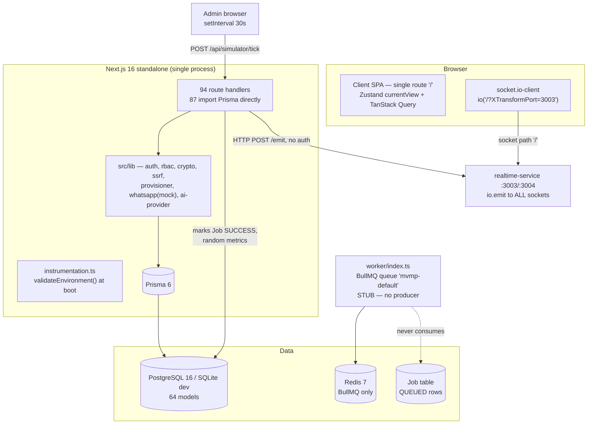

# 15 — INDEPENDENT AUDIT VALIDATION

**Project:** MVMP (Multi VPN Management Panel)
**Validation date:** 2026-11-07
**Validator role:** Independent Principal Architect / Security Engineer / DB Architect
**Scope:** Independent re-verification of `docs/project-analysis/00`–`13` against the actual source tree
**Mode:** 100% read-only. No source, config, schema, or database was modified by this validation.

---

## 1. EXECUTIVE SUMMARY

### 1.1 Verdict on the previous audit

The previous audit is **directionally correct on the big risks but factually unreliable in details**. Of the claims that could be tested statically:

| Result | Count | Share |
|---|---|---|
| **CONFIRMED** | 21 | 50% |
| **PARTIALLY CONFIRMED** | 10 | 24% |
| **FALSE POSITIVE** | 8 | 19% |
| **NOT FOUND** | 1 | 2% |
| **UNVERIFIED** | 2 | 5% |
| **Total verified claims** | **42** | 100% |

The audit **did not identify the single most severe defect in the system**: cross-tenant data exposure through shared admin list endpoints. It rated overall risk **MEDIUM**; the evidence supports **CRITICAL**.

It also **invented facts**: a Prettier config that does not exist, a BullMQ queue name and job types that do not exist, Zod validation that is not used anywhere, per-request database permission resolution that happens on only 7 of 94 routes, and performance metrics (bundle size, LCP, TTI) that cannot be produced without a build — none exists in this workspace.

Conversely, the audit **under-reported several real problems** that I confirmed independently: an unauthenticated payment webhook that ignores the payment amount, an ownership-free "create gateway payment" endpoint that chains into it, a required `SESSION_SECRET` that is never used, an inert `AI_EMERGENCY_SHUTDOWN` environment flag, and a provisioning pipeline that only "works" because a logged-in admin's browser simulates job completion every 30 seconds.

### 1.2 Actual production risk

| Dimension | Score | Basis |
|---|---|---|
| Tenant isolation | **1 / 10** | Any customer can read all customers, VPN accounts, and transactions |
| Payment integrity | **1 / 10** | Unsigned webhook + no amount check + no auto-provision |
| Secret/credential protection | **2 / 10** | VPN secrets Base64 + plaintext mirror; gateway keys readable by ADMIN |
| Authentication | **4 / 10** | Solid primitives, no brute-force defence, unsigned sessions |
| Authorization | **3 / 10** | RBAC model exists; enforcement is static and mostly tenant-blind |
| Data integrity | **3 / 10** | Float money, no migrations, non-atomic payment approval |
| Deployability | **4 / 10** | Compose build context and realtime wiring are broken |
| Testability | **0 / 10** | Zero automated tests, no runner, no CI |
| Operability | **6 / 10** | Genuinely good scripts/systemd/nginx/backup |
| UI/UX | **7 / 10** | Consistent design system; state-based navigation limits it |

**Overall: 3.1 / 10 for production use. 5.5 / 10 as an internal demo or sales prototype.**

**Recommendation: DO NOT expose to paying customers or store real VPN credentials until P0 items in §14 are closed.**

### 1.3 The three findings that change the risk picture

1. **NEW-01 + NEW-02 (exploit chain, CRITICAL).** `POST /api/payments/create-gateway` accepts an arbitrary `transactionId` from any authenticated user, with no ownership check. `POST /api/payments/webhook/[provider]` marks any payment `PAID` when a *header is merely present*, never comparing it to a secret, and never comparing the callback amount to the stored amount. A customer can therefore mark their own — or another customer's — pending transaction as paid without paying.
2. **SEC-01 (CRITICAL).** `ROLE_PERMISSIONS` grants `vpn_accounts.view`, `transactions.view`, and (for resellers) `customers.view` to non-staff roles, while `/api/customers`, `/api/vpn-accounts`, `/api/transactions` apply no tenant filter. A logged-in customer receives the platform's full customer list with names, e-mails, and phone numbers.
3. **SEC-03 + SEC-04 (CRITICAL/HIGH).** VPN credentials are `Buffer.from(uuid).toString("base64")` in `secretEncrypted` **and** duplicated in cleartext into `publicValue`; the account detail endpoint returns `publicValue` to any holder of `vpn_accounts.view`, with no ownership check.

---

## 2. VERIFICATION METHODOLOGY

### 2.1 Constraints

- No dependency installation (`node_modules` absent), no build, no database, no server start. Every runtime behaviour is therefore **inferred from code paths**, never observed.
- All checks were performed with read-only shell commands: `find`, `grep`, `wc`, `sed`, `ls`, `cat`. No write, rename, delete, migration, or network call was issued to the application.
- No secret value was read or printed. `.env.production.example` was inspected by key name only in prior work; this validation did not read it at all.

### 2.2 Method

1. **Claim extraction** — every assertion in `00`–`13` that names a file, a count, a configuration, or a behaviour was listed.
2. **Direct source inspection** — the named file was opened and the specific construct verified.
3. **Counter-search** — for negative claims ("no X"), the entire tree was searched with multiple patterns before accepting the negative (`csrf|origin|sec-fetch-site`, `jest|vitest|playwright|cypress`, `prettier`, `ioredis|createClient`, `safeParse|z.object`).
4. **Recomputation of counts** — all numeric claims (files, routes, handlers, models, indexes, dependencies, LOC) were recomputed with explicit commands.
5. **Status assignment** — CONFIRMED / PARTIALLY CONFIRMED / FALSE POSITIVE / NOT FOUND / UNVERIFIED, with evidence quoted.
6. **Gap hunt** — independent review of high-risk surfaces the prior audit did not cover (payment creation, server map, API-key issuance, environment validation, simulator, domain routing).

### 2.3 Baseline facts recomputed (authoritative for this report)

| Fact | Value | Command basis |
|---|---|---|
| Files (excl. `node_modules`, `.next`, `.git`, `.freebuff`) | **388** (373 when the prior audit began) | `find . -type f \| wc -l` |
| Source LOC (`src/**/*.ts{,x}`) | **54,867** | `wc -l` |
| Route files / exported handlers | **94 / 139** | `find src/app/api -name route.ts`; `grep "export async function"` |
| Handlers by verb | GET **62**, POST **47**, PATCH **17**, DELETE **13**, PUT 0 | `grep -rhoE` |
| React component files | **103** | `find src/components -name "*.tsx"` |
| shadcn primitives | **48** | `ls src/components/ui/*.tsx` |
| Library modules / LOC | **19 / 3,841** | `ls src/lib`; `wc -l` |
| Prisma models / enums / relations | **64 / 9 / 62** | `grep -c` |
| Prisma `@@index` / `@@unique` | **79 / 4** | `grep -c` |
| Runtime / dev dependencies | **73 / 10** | `package.json` |
| Routes importing `@/lib/db` directly | **87 / 94** | `grep -rl` |
| Static role checks (`hasPermission(user.role…)`) | **100** | `grep -rn` |
| Routes using DB-backed RBAC | **7** (+ `rbac.ts`) | `grep -rl hasPermissionDb\|getUserPermissions` |
| Mutation handlers / routes with mutations | **77 / 66** | `grep` |
| Routes writing audit log | **57** (69 calls) | `grep -rl auditLog` |
| Mutation routes **without** audit log | **9** | loop over route files |
| Generic `INTERNAL` 500 responses | **120** | `grep -c` |
| `req.json()` call sites / Zod validators | **55 / 0** | `grep` |
| `as any` occurrences | **104** | `grep` |
| ESLint rules explicitly disabled | **27** | `grep -c '"…": "off"'` |
| Automated test files / runners | **0 / 0** | `find`, `ls` |
| Prisma migrations | **0** (no directory) | `ls prisma/` |
| Git repository / CI pipeline | **none / none** | `ls -d .git .github` |

---

## 3. ARCHITECTURE VERIFICATION

### 3.1 Actual architecture (verified)



**Verified characteristics**

| Aspect | Finding | Status |
|---|---|---|
| Process model | Next.js API + standalone BullMQ worker + standalone socket.io service + a systemd "agent" unit that its own file declares **not used** | CONFIRMED |
| Layering | No controller/service/repository split: 87 of 94 routes query Prisma directly; business logic (provisioning, payment approval) lives inside handlers | CONFIRMED |
| Auth middleware | **No `middleware.ts`**; each handler calls `getSessionUser()` itself (136 call sites) | CONFIRMED |
| Job pipeline | Provisioner writes `Job` rows with `status: QUEUED`; no consumer exists; BullMQ queue `mvmp-default` has no producer; only `simulator/tick` transitions jobs to `SUCCESS` | CONFIRMED |
| Realtime | socket.io path `/`, CORS `*`, no auth, `io.emit` to every client; HTTP emit on `:3004` unauthenticated | CONFIRMED |
| Domain routing | `page.tsx` decides admin vs landing in the browser via `hostname.includes("customer")` — no rewrites/middleware, so `mvmp.id` heuristics are the only separation | CONFIRMED |
| Separation of concerns | Payment approval writes Payment, then Transaction, then provisions, then sends WhatsApp — four side effects, no transaction boundary | CONFIRMED |
| Documented BullMQ integration | Prior doc `02` claims queue `vpn-provisioning` with job types "protocol installation, email sending, backup". Actual queue is `mvmp-default`, handler is a no-op logging stub, comment says "currently never produced to" | **FALSE POSITIVE** (see §10, FP-05) |
| Documented authorization flow | Prior doc `02` claims every request fetches cached permissions. Actual: 7 routes use `rbac.ts`; 100 checks use the static role map | **FALSE POSITIVE** (FP-06) |

### 3.2 Architecture findings

**ARCH-V1 — Provisioning is an illusion sustained by the browser (CRITICAL for functionality)**
- Location: `src/lib/provisioner.ts` (Job creation, lines ~186–198), `src/worker/index.ts` (stub), `deploy/systemd/mvmp-agent.service` (declares "NOT USED in current repository"), `src/app/api/simulator/tick/route.ts` (lines 135–165), `src/components/mvmp/AppShell.tsx:305–310`.
- Evidence: provisioner creates `Job` rows; worker listens on `mvmp-default` and only logs; agent unit states there is no Go agent; simulator marks `QUEUED` jobs `PROCESSING` then `SUCCESS` and flips accounts to `ACTIVE`.
- Explanation: no component in this repository executes provisioning against a real server.
- Impact: without an admin browser open every 30 s, accounts stay `PENDING`/`QUEUED` indefinitely. With it, accounts are marked active without any configuration ever being written to a VPS.
- Recommendation: implement the agent/SSH executor or explicitly reclassify the product as a demo. Remove simulator writes from production build paths.
- **Status: CONFIRMED (new).**

**ARCH-V2 — No middleware, no shared route guard (HIGH)**
- Location: absence of `src/middleware.ts`; 136 `getSessionUser()` call sites; 9 authenticated routes with no permission check (`api-keys`, `api-keys/[id]`, `chat`, `notifications`, `notifications/[id]/read`, `payments/create-gateway`, `servers/map`, `auth/me`, `auth/logout`).
- Impact: authorization coverage depends on the author remembering it per file — and in 9 cases they did not.
- Recommendation: single `withAuth(permission, handler)` wrapper or middleware-based session gate plus per-route scope checks.
- **Status: CONFIRMED.**

**ARCH-V3 — Two out-of-band components are documented but absent or inert**
- `deploy/systemd/mvmp-agent.service` exists but is explicitly not installed and points at a binary that is never built.
- Redis is provisioned in Compose and required by `env-validate.ts` for the **API**, yet the API never opens a Redis connection (only `worker/index.ts` and two `scripts/phase12-2-*` diagnostics do).
- **Status: CONFIRMED.**

---

## 4. SECURITY VERIFICATION

### 4.1 Verified critical/high findings

---

**SEC-01 — Cross-tenant data exposure via shared admin endpoints**
- **Priority:** CRITICAL
- **Location:** `src/lib/auth.ts` (`ROLE_PERMISSIONS`), `src/app/api/customers/route.ts:25`, `src/app/api/vpn-accounts/route.ts:22`, `src/app/api/transactions/route.ts:16`.
- **Evidence:**
  - `RESELLER: ["dashboard.view","vpn_accounts.view","customers.view","transactions.view","packages.view"]`
  - `CUSTOMER: ["dashboard.view","vpn_accounts.view","transactions.view","packages.view"]`
  - `customers` GET builds `where` only from `searchParams` (`resellerId` is an optional *filter*, not an enforced scope).
  - `vpn_accounts` GET returns `customer: { name, email, customerCode }` for the whole platform.
  - `transactions` GET likewise.
- **Explanation:** the permission model conflates "may view this module" with "may view every row in this module". No query is scoped to `user.id` → `Customer.userId` or `Reseller.userId`.
- **Impact:** any paying customer who logs in can enumerate all customers (PII: name, e-mail, phone), all VPN accounts (usernames, server IPs), and all invoices. This is a personal-data breach under UU PDP/GDPR and a direct competitive-intelligence leak.
- **Recommendation:** derive a `scope` from the session inside a shared guard (`CUSTOMER → customerId`, `RESELLER → resellerId subtree`, staff → all) and apply it to every list/detail query; add two-tenant integration tests.
- **Status: CONFIRMED.** The prior audit **did not report this**.

---

**SEC-02 — Payment webhook accepts forged callbacks (no real signature verification)**
- **Priority:** CRITICAL
- **Location:** `src/app/api/payments/webhook/[provider]/route.ts:16–24, 100–130`.
- **Evidence:**
  ```ts
  const signature = req.headers.get("x-callback-token") || req.headers.get("signature") || "";
  if (!signature && process.env.NODE_ENV === "production") { /* 401 */ }
  ```
  No HMAC, no `timingSafeEqual`, no comparison against `webhookToken`/`serverKey`/`sharedKey`. The comment block describes the algorithms but none is implemented. The route has no `getSessionUser` and no IP allow-list.
- **Impact:** anyone who can reach the endpoint (public by design) can mark any payment and its transaction `PAID` by supplying a header and a known/guessed `providerReference`. In development the header check is skipped entirely.
- **Recommendation:** implement per-provider verification (Xendit callback token compare, Midtrans SHA-512 of `order_id+status_code+gross_amount+server_key`, DOKU/iPaymu HMAC over raw body), compare with `crypto.timingSafeEqual`, persist raw payload, make the handler idempotent, and never trust `status` alone.
- **Status: CONFIRMED.**

---

**SEC-03 — VPN credentials are Base64, not encrypted, and mirrored in cleartext**
- **Priority:** CRITICAL
- **Location:** `src/lib/provisioner.ts:175–183`; `prisma/schema.prisma` (`VpnCredential.secretEncrypted`, `.publicValue`).
- **Evidence:**
  ```ts
  const credUuid = uuidv4();
  secretEncrypted: Buffer.from(credUuid).toString("base64"),  // reversible, no key
  publicValue: credUuid,                                       // same secret, plaintext
  ```
  `src/lib/crypto.ts` (AES-256-GCM) is **not** used here — only for AI provider keys and Telegram tokens.
- **Impact:** a database dump, a backup, or any API response containing `publicValue` (see SEC-04) yields working VPN credentials. The field name `secretEncrypted` actively misleads reviewers and auditors.
- **Recommendation:** encrypt with `crypto.ts`, drop `publicValue` or store only a masked form, and rotate all existing credentials after migration.
- **Status: CONFIRMED.** Prior doc `08` claimed AES-256-GCM "data protection" as a strength without noting this gap.

---

**SEC-04 — IDOR on VPN account detail**
- **Priority:** HIGH
- **Location:** `src/app/api/vpn-accounts/[id]/route.ts:22–52`.
- **Evidence:** guard is only `hasPermission(user.role, "vpn_accounts.view")`; query is `findUnique({ where: { id } })` with `credentials.publicValue` and full customer PII included; no `customerId`/`resellerId` comparison.
- **Impact:** any customer or reseller can read any account's credentials and owner data by ID (cuid IDs are enumerable via SEC-01's list).
- **Recommendation:** after fetching, assert ownership (`account.customer.userId === user.id` or reseller subtree) before returning; omit credential material from staff-wide reads.
- **Status: CONFIRMED.**

---

**SEC-05 — OTP is returned in the API response in every environment**
- **Priority:** HIGH
- **Location:** `src/lib/otp.ts:177–186` (`mockOtp: plaintext`), `src/app/api/security/otp/request/route.ts:48–58`.
- **Evidence:** route comment says *"undefined in production"*; the library returns it unconditionally — there is no `NODE_ENV` guard in `otp.ts`. Route passes `mockOtp: result.mockOtp` straight into the JSON body.
- **Impact:** OTP is not a second factor at all. Combined with `security/change-password` (which requires only an OTP, not the old password), any session hijack becomes a permanent account takeover.
- **Recommendation:** remove `mockOtp` from the response type; deliver via SMTP/SMS in all environments; gate test helpers behind `NODE_ENV === "test"` only.
- **Status: CONFIRMED.**

---

**SEC-06 — Database RBAC is bypassed by the static role map**
- **Priority:** HIGH
- **Location:** `src/lib/auth.ts` (`hasPermission`, `ROLE_PERMISSIONS`), `src/lib/rbac.ts` (`hasPermissionDb`), 100 call sites.
- **Evidence:** `grep -rl "hasPermissionDb|getUserPermissions" src` → 7 API routes + `rbac.ts`. `grep -c "hasPermission(user.role"` → 100. The UI exposes a Role/Permission matrix (`RolePermissionMatrix.tsx`, 939 LOC) that edits DB rows nothing enforces.
- **Impact:** administrators believe they can revoke a permission; the API ignores it. This is a false sense of security and a compliance failure (access control not operating as configured).
- **Recommendation:** replace `hasPermission(role, key)` with an async `can(userId, key)` backed by `rbac.ts`; keep the static map only as seed data.
- **Status: CONFIRMED.**

---

**SEC-07 — No login throttling, lockout, or failed-login audit**
- **Priority:** HIGH
- **Location:** `src/app/api/auth/login/route.ts` (entire file).
- **Evidence:** no `checkRateLimit`, no attempt counter, no `security.login_max_attempts` read (the setting is seeded but unused), audit only on success. `RATE_LIMITS` defines 4 profiles but only `chat` is consumed (`grep checkRateLimit` → 1 route).
- **Additional:** when the e-mail is unknown the handler returns before `bcrypt.compare`, so response time distinguishes existing accounts (user enumeration).
- **Impact:** unlimited credential stuffing; nginx's `limit_req` (5 r/m) exists only in the sample production vhost, not in dev/Caddy/Docker-internal calls.
- **Recommendation:** per-IP + per-account counters (Redis), constant-time dummy hash for unknown users, audit `LOGIN_FAILED`, temporary lockout after N failures.
- **Status: CONFIRMED.**

---

**SEC-08 — Payment-gateway secrets readable through the generic settings endpoint**
- **Priority:** HIGH
- **Location:** `src/app/api/settings/providers/route.ts:71–92` (creates `payment.providers` with `isSensitive: false`), `src/app/api/settings/system/route.ts:45–57` (returns every row where `!isSensitive`).
- **Evidence:** the stored JSON contains `xendit.apiKey`, `midtrans.serverKey`, `doku.sharedKey`, `ipaymu.apiKey`, `payoutApiKey`. The providers endpoint masks them for its own GET, but `/api/settings/system` returns the same row unmasked to any holder of `settings.view` (ADMIN and SUPER_ADMIN).
- **Impact:** live payment credentials exposed to mid-level admins and to browser devtools/network logs; also persisted in any client-side cache.
- **Recommendation:** mark the row sensitive at creation, split secrets into a dedicated encrypted table, never return them through a bulk endpoint.
- **Status: CONFIRMED.**

---

**SEC-09 — Three production roles have zero permissions**
- **Priority:** HIGH (functional/authorization)
- **Location:** `prisma/schema.prisma` `enum UserRole` (7 values) vs `src/lib/auth.ts` `ROLE_PERMISSIONS` (4 keys).
- **Evidence:** `OPERATOR`, `FINANCE`, `CUSTOMER_SERVICE` are absent from the map; `hasPermission` returns `false` for every key. `scripts/seed.ts` creates `ops@mvmp.id` with role `OPERATOR`.
- **Impact:** these accounts can authenticate but every API returns 403; the seeded operator is unusable. Also `RESELLER` lacks `resellers.manage` and `ADMIN` lacks `settings.manage`/`ai.manage`/`users.manage`, so the settings UI visible to ADMIN fails on save with 403.
- **Recommendation:** seed DB-backed role assignments for all 7 roles and migrate checks to `rbac.ts`; or reduce the enum to the supported roles.
- **Status: CONFIRMED.**

---

**SEC-10 — Realtime bus is unauthenticated and broadcast-only**
- **Priority:** HIGH
- **Location:** `mini-services/realtime-service/index.ts:10–60`; `src/lib/realtime.ts:6`; `src/components/mvmp/RealtimeBridge.tsx:36`.
- **Evidence:** `new Server(SOCKET_PORT, { path: "/", cors: { origin: "*" } })`, no handshake auth, `io.emit(event, payload)` on every emit, `POST /emit` on `:3004` with no token. Client connects with `io("/?XTransformPort=3003")`.
- **Impact:** (a) any socket receives every tenant's notification text and account events; (b) any process able to reach `:3004` can inject arbitrary `realtime:*` events into every operator's UI (e.g., fake "payment received" toasts).
- **Recommendation:** authenticate the handshake with the session cookie, join per-user/per-tenant rooms, emit to rooms only, bind `:3004` to loopback and require a shared secret.
- **Status: CONFIRMED.**

---

**SEC-11 — CSRF: no token, no origin check**
- **Priority:** MEDIUM (downgraded from HIGH)
- **Location:** whole API surface; `grep -i "csrf|sec-fetch-site|origin ==="` → **0 hits**.
- **Evidence:** cookie is `httpOnly`, `sameSite: "lax"`, `secure` only in production (`src/lib/auth.ts:125–135`). No `__Host-` prefix, no double-submit token, no `Origin` validation.
- **Explanation:** `SameSite=Lax` blocks cross-site cookie attachment on POST, and `req.json()` rejects simple form posts, so classic CSRF is largely mitigated by accident. Residual risk: any XSS or same-site subdomain becomes full account takeover; `Lax` also permits top-level GET navigation with cookies.
- **Impact:** lower than the prior audit's HIGH, but the absence of defence-in-depth remains real.
- **Recommendation:** validate `Origin`/`Sec-Fetch-Site` on all mutations, add `__Host-` cookie prefix, consider strict SameSite with a refresh flow.
- **Status: PARTIALLY CONFIRMED** (finding real; severity overstated).

---

**SEC-12 — Session tokens are unsigned; `SESSION_SECRET` is required but never used**
- **Priority:** HIGH
- **Location:** `src/lib/auth.ts:12, 69–87, 95–110, 125–135`; `src/lib/env-validate.ts:68`.
- **Evidence:** token is `uuidv4() + "." + uuidv4()`, stored verbatim in `Session.token`, looked up by equality. `grep SESSION_SECRET src` → only the validator; no HMAC anywhere. TTL is hard-coded 24 h (`SESSION_TTL_HOURS = 24`); `SESSION_TTL_HOURS` env and `general.session_timeout_minutes` setting are ignored.
- **Impact:** session hijack via any read of the `Session` table or a log/backup; tokens are bearer-forever for 24 h with no rotation, no device binding, and no idle timeout. The required secret gives a false impression that tokens are signed.
- **Recommendation:** store only a SHA-256 of the token, sign or use opaque high-entropy tokens with rotation, honour configured TTL, add idle timeout and "revoke other sessions" on password change (partially present).
- **Status: CONFIRMED** (existence), **PARTIALLY CONFIRMED** (prior rationale "forgeable if DB compromised" is weak — a DB attacker can read tokens anyway; the real issue is plaintext storage and no expiry policy).

---

**SEC-13 — SSRF protection is partially applied**
- **Priority:** MEDIUM
- **Location:** `src/lib/ssrf.ts`, `src/lib/ai-provider.ts:16, 502`, `src/app/api/ai/providers/fetch-models/route.ts:84`.
- **Evidence:** `validateProviderUrl` is called before provider requests; `validateDnsResolution` is imported in `ai-provider.ts` but **never called** there; only `fetch-models` resolves DNS. Dev allows `http://localhost/127.0.0.1` (production refuses).
- **Impact:** DNS-rebinding TOCTOU remains for chat/test paths; a hostname resolving to `169.254.169.254` at request time is not re-checked.
- **Recommendation:** resolve and pin the IP used for the connection, re-validate after redirects, deny redirects to private ranges.
- **Status: PARTIALLY CONFIRMED.** Prior doc `08` listed "DNS Resolution Check" as a *strength* — misleading (FP-04).

---

**SEC-14 — Audit logging is broad but incomplete and non-compliant**
- **Priority:** MEDIUM
- **Location:** 57 route files, 69 calls; `src/lib/auth.ts` `auditLog`.
- **Evidence:** 9 mutation routes have no audit call, including the payment webhook, `payments/create-gateway`, `security/otp/verify`, `notifications/[id]/read`, and provider tests. Failed logins are never logged. `AUDIT_LOG_RETENTION_DAYS` is referenced nowhere in `src`; no pruning job exists. `metadata` stores e-mails and target identifiers in plain JSON.
- **Impact:** no forensic trail for the highest-risk operations; unbounded growth; PII in logs.
- **Recommendation:** enforce audit inside a shared mutation wrapper, log failures, add retention job, redact PII.
- **Status: CONFIRMED.**

---

**SEC-15 — No security headers at the application layer**
- **Priority:** MEDIUM
- **Location:** `next.config.ts` (no `headers()`), `deploy/nginx/mvmp.conf` (HSTS/CSP present), `Caddyfile` (none).
- **Impact:** deployments that bypass nginx (Caddy sandbox, direct `:3000`, Docker port 3001) serve without CSP/HSTS/X-Frame-Options.
- **Recommendation:** define headers in `next.config.ts` so every deployment inherits them.
- **Status: CONFIRMED.**

---

**SEC-16 — API keys are issued but never accepted**
- **Priority:** MEDIUM (security theatre + dead feature)
- **Location:** `src/app/api/api-keys/route.ts`, `src/app/api/api-keys/[id]/route.ts`.
- **Evidence:** keys are generated (`fullKey`, SHA-256 `keyHash`, `keyPrefix`, `scopes`) and persisted; `grep` for any verifier (`x-api-key` auth middleware, `verifyApiKey`, `keyHash` lookup) finds **none** outside the AI-provider's own upstream key handling. Both routes only check `getSessionUser` — no permission — so any customer can mint keys.
- **Impact:** a documented "API access" feature that grants nothing; users may paste these keys into third-party tools believing they work. No privilege escalation is possible today only because nothing consumes them.
- **Recommendation:** implement a verifier (`Authorization: Bearer`, hash lookup, scope check, `lastUsedAt`) or remove the feature and its UI.
- **Status: CONFIRMED.** Prior doc `07` marked it COMPLETE (FP-10).

---

### 4.2 Verified positives (do not regress these)

| Control | Evidence | Status |
|---|---|---|
| Password hashing | `bcrypt.hash(..., 10)` in seed/users; `bcrypt.compare` on login | CONFIRMED |
| AES-256-GCM with auth tag + versioned format | `src/lib/crypto.ts:117–186`; used for AI provider keys and Telegram token | CONFIRMED |
| Encryption key required in production | `env-validate.ts` + `validateEncryptionOnStartup()` called from `instrumentation.ts` and worker | CONFIRMED |
| No raw SQL | `grep '$queryRaw\|$executeRaw'` → 0 | CONFIRMED |
| No shell execution | no `child_process`/`exec` in `src` | CONFIRMED |
| Session revocation on password change | `security/change-password` revokes other sessions in one `updateMany` | CONFIRMED |
| Reseller portal scopes by owner | `portal/reseller/create-account` asserts `customer.resellerId === reseller.id` | CONFIRMED |
| Customer portal scopes by owner | `portal/customer/my-accounts` derives `customerId` from the session | CONFIRMED |
| SSRF blocklist for metadata/private ranges | `src/lib/ssrf.ts` | CONFIRMED |

---

## 5. REDIS & CACHING VERIFICATION

**Prior claim (00 §5, 08-H3, 10-§3):** Redis is provisioned; rate limiting is in-memory; caching absent.

| Question | Answer | Evidence | Status |
|---|---|---|---|
| Is Redis used at all? | Yes — **only** by `src/worker/index.ts` (`new Redis(REDIS_URL)`) and two diagnostic scripts | `grep ioredis\|createClient` | CONFIRMED |
| Only for BullMQ? | Yes. The worker registers a BullMQ `Worker` + `QueueEvents`; no cache reads/writes, no session store, no rate-limit counters | `worker/index.ts:42–75` | CONFIRMED |
| Is caching implemented? | No application cache. Only the 10-second in-process permission map (`rbac.ts`) and TanStack Query's browser cache | `rbac.ts:permissionCache` | CONFIRMED |
| Rate limiting: Redis or memory? | **Memory** — `const buckets = new Map<string, RateLimitBucket>()` in `src/lib/rate-limit.ts`; consumed by **one** route (`/api/chat`) | `grep checkRateLimit` | CONFIRMED |
| Is `RATE_LIMIT_*` configuration effective? | **No.** Compose injects `RATE_LIMIT_CHAT_PER_MIN` and `RATE_LIMIT_AI_AGENT_PER_MIN`; `grep "RATE_LIMIT_" src` → 0 reads. Values are hard-coded (20/min chat) | `rate-limit.ts:22–26` | CONFIRMED |
| Is production configuration correct? | Partially. Redis has `noeviction`, AOF + RDB, dangerous commands renamed, `protected-mode yes`, but `bind 0.0.0.0` relies on network isolation; password injected by Compose args | `deploy/docker/redis/redis.conf` | CONFIRMED |
| Does the API need Redis? | **Declared yes, actually no.** `env-validate.ts` marks `REDIS_URL` `requiredInProd: true` and `instrumentation.ts` exits the process when missing, but no API code opens a Redis connection | `env-validate.ts:41–46` | **NEW-05** |

**Assessment.** Redis is a **deployment dependency without an application consumer**. The single real benefit (BullMQ) is itself inert because no producer exists. Any horizontal scaling today would multiply rate-limit budgets by the number of instances and would not share sessions — exactly as the prior audit said, but for a narrower surface than claimed.

**NEW-05 — false production dependency (HIGH, deployability)**
- Location: `src/lib/env-validate.ts:41–46`, `src/instrumentation.ts`.
- Impact: an API deployment without `REDIS_URL` refuses to boot even though it would function; conversely operators believe Redis is load-bearing for the API and size/secure it accordingly.
- Recommendation: require `REDIS_URL` only for the worker, or actually use Redis for rate limits/sessions/cache.

---

## 6. TESTING VERIFICATION

I searched the **entire** tree (not just conventional config names) for tests, runners, fixtures, and CI before concluding coverage.

| Search | Command | Result |
|---|---|---|
| Test-file names anywhere | `find . -iname "*test*" -o -iname "*spec*"` | 5 manual scripts (`scripts/test-*.js`), 1 deploy script (`phase14-test.sh`), 1 JSON report, 1 false hit (`aspect-ratio.tsx`) |
| Runner configs | `ls jest.config.* vitest.config.* playwright.config.* cypress.config.* .mocharc*` | none |
| Test directories | `find . -type d \( -name __tests__ -o -name tests -o -name e2e \)` | none (only route folders named `.../test`) |
| `test` npm script | `package.json` | **absent** (`dev`, `build`, `start`, `lint`, `db:*`) |
| CI | `.github`, `.gitlab-ci.yml`, `.circleci` | none |
| Coverage tooling | `package.json` | none |

**Assessment**

- Automated tests: **0**. Coverage: **0%** — this is not an inference from a missing config; there is no executable test file or runner anywhere.
- Manual assets exist but are not runnable here: `node_modules` absent, no database, scripts assume a live server on localhost (`test-provision.js`, `test-wa-payment.js`, `check-wa.js`).
- `scripts/_verify-screenshots/` contains 44 PNGs plus JSON reports — evidence of past manual UI verification, not a regression suite.
- Prior doc `11` conclusion "0% tests" is **CONFIRMED**; its subsidiary claims are not (see FP-01, FP-02, FP-17).

**Status: CONFIRMED** (no automated testing), with the correction that manual test scripts and visual artifacts do exist.

---

## 7. CODE QUALITY VERIFICATION

| Claim / area | Evidence | Status |
|---|---|---|
| "No linter configuration visible" (11) | `eslint.config.mjs` exists, extends `next/core-web-vitals` + `next/typescript`, ignores `scripts/**`, and disables **27** rules | **FALSE POSITIVE** |
| "`prettier.config.js` exists" (11) | No Prettier config, dependency, or script anywhere | **FALSE POSITIVE** (fabricated) |
| Type safety | `tsconfig.strict: true`, but `next.config.ts` sets `typescript.ignoreBuildErrors: true`; no `typecheck` script; **104** `as any` | PARTIALLY CONFIRMED |
| Code duplication | 100 identical `getSessionUser → hasPermission(user.role, …) → 401/403` blocks; 120 identical `INTERNAL` 500 blocks; 55 raw `req.json()` parses | CONFIRMED |
| Error handling | Uniform envelope, but no error codes taxonomy beyond ~15 strings, no correlation ID, `console.error(e?.message)` only (stack lost), 9 mutation routes without audit | CONFIRMED |
| Centralized validation | **0** Zod validators; `safeParseScopes` is a local JSON helper, not Zod. `zod` is a dependency with no import | **FALSE POSITIVE** (prior "Zod validation where used") |
| Unused dependencies | `next-auth`, `next-intl`, `z-ai-web-dev-sdk`, `@dnd-kit/core|sortable|utilities`, `@tanstack/react-table`, `@mdxeditor/editor`, `@reactuses/core` → 0 imports in `src` | CONFIRMED (9 packages) |
| Oversized modules | `AICenterView.tsx` 3,247 LOC; `UserManagement.tsx` 1,390; `VpnAccountsView.tsx` 1,281; `SettingsView.tsx` 1,168 | CONFIRMED |
| Build hygiene | `reactStrictMode: false`, `db:push: prisma db push --accept-data-loss`, schema `.bak` committed, no formatter, no hooks | CONFIRMED |
| Duplicate UI systems | `layout.tsx` mounts both Radix `Toaster` and `sonner` | CONFIRMED |
| Measured quality metrics (~10% duplication, cyclomatic 15, debt 20%) (11) | No tool run, no report, no baseline | **UNVERIFIED** |

**NEW-08 — `SESSION_SECRET` required but unused (HIGH, security theatre)** — see SEC-12.

**NEW-09 — Dead safety switches in environment (MEDIUM)**
- `AI_CHATBOT_ENABLED`: 0 reads in `src` (only Compose injection).
- `AI_MAX_INPUT_TOKENS`, `AI_MAX_OUTPUT_TOKENS`: 0 reads.
- `AI_EMERGENCY_SHUTDOWN`: 0 reads in `src`; the *database* setting `emergencyShutdown` **is** honoured (`ai-provider.ts:348`), so the env flag operators set in Compose does nothing.
- Impact: an operator who "disables the chatbot" or "triggers emergency shutdown" via env believes the system is off while it keeps answering and spending credits.
- Recommendation: read the flags at request time (or remove them from Compose/example env to avoid the illusion).
- Status: CONFIRMED.

---

## 8. API VERIFICATION

### 8.1 Count reconciliation

| Source | Claim | Verified | Verdict |
|---|---|---|---|
| `06_API_ANALYSIS.md:5` | "**~120 endpoints**" | **94 route files / 139 operations** (GET 62, POST 47, PATCH 17, DELETE 13) | **PARTIALLY CONFIRMED** — the count is wrong by ~16–45% depending on what is counted |
| `00` §3 | 94 route files, 139 handlers | matches | CONFIRMED |
| `01` §2 | 94 routes, 62/47/17/13 | matches | CONFIRMED |

### 8.2 Authentication coverage

| Category | Count | Routes |
|---|---|---|
| No session check by design | 1 | `POST /api/auth/login` |
| No session check **and** no other auth | 2 | `POST /api/payments/webhook/[provider]`, `GET /api` (hello-world) |
| Session but **no permission/role check** | 9 | `api-keys` (GET/POST), `api-keys/[id]`, `chat`, `notifications`, `notifications/[id]/read`, `payments/create-gateway`, `servers/map`, `auth/me`, `auth/logout` |
| Session + static role check | ~82 | remainder |
| Session + DB RBAC | 7 | `rbac/*` (3), `settings/system`, `users` (2), `users/[id]/reset-password` |

### 8.3 Validation & response handling

- **Request validation:** ad hoc `if (!field)` checks; 55 `req.json()` sites; 0 schema validators. No length/format/range enforcement for free-text fields (names, notes, server hostnames), no enum validation against Prisma enums (`status` accepts arbitrary strings in several PATCH handlers).
- **Response envelope:** consistent `{ success, data | error: { code, message } }` — a genuine strength.
- **Error codes:** ~15 distinct codes, but 120 handlers collapse everything to `INTERNAL` with a generic Indonesian message and `console.error` — no correlation ID, so support cannot tie a user report to a log line.
- **Pagination:** `page`/`limit` with `limit ≤ 100` on customers, vpn-accounts, transactions, audit-logs; **absent** on `servers/map`, `notifications`, `rbac/permissions`, `ai/*` lists, `whatsapp` lists → unbounded payloads as data grows.
- **Versioning / docs:** none; no OpenAPI/Swagger file anywhere (prior `07` "MISSING" → CONFIRMED).
- **Idempotency:** provisioning uses `idempotencyKey` and `payloadHash` fields but the values are random UUID slices, so they provide no de-duplication guarantee.

**API findings**

| ID | Finding | Location | Impact | Status |
|---|---|---|---|---|
| API-01 | Ownership-free payment creation (see NEW-02) | `payments/create-gateway/route.ts:32–70` | Any user can repoint any pending transaction to a new provider reference | CONFIRMED |
| API-02 | Server fleet disclosure to any authenticated user | `servers/map/route.ts:33–110` | Customers receive hostnames, public IPs, capacity, agent versions of every VPS | CONFIRMED |
| API-03 | API-key issuance without permission | `api-keys/route.ts:69` | Any role can mint keys; harmless only because nothing verifies them | CONFIRMED |
| API-04 | Unbounded list endpoints | `ai/*`, `notifications`, `servers/map` | Memory/latency growth; no pagination contract | CONFIRMED |
| API-05 | Non-atomic payment approval | `payments/[id]/approve/route.ts:46–60` | Payment can be PAID while Transaction update or provisioning fails | CONFIRMED |

---

## 9. DATABASE VERIFICATION

### 9.1 Model reconciliation

| Claim | Verified | Verdict |
|---|---|---|
| `64 models / 9 enums` (01, 05) | 64 / 9 | CONFIRMED |
| `~50 indexes` (05) | **79 `@@index`** + 4 `@@unique` | **PARTIALLY CONFIRMED** (undercounted by ~37%) |
| 62 relations | 62 `@relation` | CONFIRMED |
| Telegram model in both schemas | `schema.prisma`: 1; `schema.postgres.prisma`: **0** | CONFIRMED drift |
| Migrations exist | **no `prisma/migrations/`**; scripts use `db push --accept-data-loss` and `migrate dev` | CONFIRMED missing |

### 9.2 Integrity findings

| ID | Finding | Evidence | Impact | Status |
|---|---|---|---|---|
| DB-01 | Schema drift: `TelegramIntegration` absent from PostgreSQL schema | `grep -c "model TelegramIntegration"` → 1 / 0 | Every `db.telegramIntegration.*` call fails at runtime in production; `/api/telegram/config` and UI break | CONFIRMED |
| DB-02 | No migration history | `prisma/migrations` absent; `db:push --accept-data-loss` | Destructive, unreviewable schema changes; no rollback path; environments can diverge | CONFIRMED |
| DB-03 | Money stored as `Float` | `Payment.amount`, `Transaction.amount`, `ResellerLedger.amount/balanceAfter`, `Reseller.balance`, `Package.price`, `Server.monthlyCost` | Rounding drift in balances and invoices; unacceptable for payments | CONFIRMED |
| DB-04 | Free-text statuses | 20 `status String` fields outside enums (e.g., `Customer.status`, `Reseller.status`, `VpnAccount.role`-adjacent fields) | Invalid states persist; filters silently miss rows | CONFIRMED |
| DB-05 | `Payment.providerReference` neither unique nor indexed | model block shows only `@@index([status])`, `@@index([transactionId])` | Webhook resolution by `findFirst` scans and can match the wrong payment when references collide | CONFIRMED |
| DB-06 | No composite uniqueness for VPN identity | `VpnAccount` has `username String` + `@@index([serverId])` but no `@@unique([serverId, username])` | Duplicate usernames per server; agent-side collisions | CONFIRMED |
| DB-07 | Account numbering derived from row count | `provisioner.ts:132` `db.vpnAccount.count()` | Concurrent provisioning yields duplicate sequential numbers | CONFIRMED |
| DB-08 | Ledger entry has no FK to transaction | `ResellerLedger.transactionId String?` with relation only to `Reseller` | Orphan ledger rows; reconciliation impossible | CONFIRMED |
| DB-09 | Non-atomic multi-write flows | `approve` route updates Payment then Transaction; provisioner creates subscription, accounts, credentials, jobs sequentially | Partial states (PAID without accounts, accounts without credentials) | CONFIRMED |
| DB-10 | Unbounded growth tables | `AuditLog`, `ServerMetric`, `VpnUsage`, `EmailLog`, `WhatsAppMessage` have no retention job (`AUDIT_LOG_RETENTION_DAYS` unused in `src`) | Storage/latency growth; backup bloat | CONFIRMED |

**Positive:** no raw SQL anywhere; all access through Prisma parameterization; `Session.token` unique index exists; `BigInt` fields are normalized via `serialize()` (at the cost of a full JSON round-trip per response and precision loss above 2^53).

---

## 10. FALSE POSITIVE FINDINGS

These are claims in the prior documentation that the source does **not** support.

| ID | Prior claim | Location in doc | Reality | Verdict |
|---|---|---|---|---|
| FP-01 | "No linter configuration visible" | `11` §Code Quality, P0-1 | `eslint.config.mjs` exists (flat config, 27 rules off, `scripts/**` ignored), `lint` script present | **FALSE POSITIVE** |
| FP-02 | "`prettier.config.js` exists" | `11` §Formatting | No Prettier config/dependency/script | **FALSE POSITIVE** (fabricated) |
| FP-03 | "Zod Validation: schema validation where used" | `08` §7, `08` strengths | 0 Zod imports; only a hand-written `safeParseScopes` helper | **FALSE POSITIVE** |
| FP-04 | "DNS Resolution Check" listed as SSRF strength | `08` §4 | `validateDnsResolution` imported but **unused** in `ai-provider.ts`; called only in `fetch-models` | **PARTIALLY CONFIRMED** |
| FP-05 | BullMQ queue `vpn-provisioning` with 5 job types | `02` §BullMQ Integration | Actual queue `mvmp-default`, no-op stub, no producer, comment says "never produced to" | **FALSE POSITIVE** |
| FP-06 | "User permissions fetched (cached 10s)" on every request | `02` §Authorization Flow | Only 7 routes call DB RBAC; 100 use the static map | **FALSE POSITIVE** |
| FP-07 | "6 roles" in RBAC | `08` §2 | 7 enum roles; 4 mapped; 3 have zero permissions | **FALSE POSITIVE** |
| FP-08 | "~120 endpoints" | `06:5` | 94 paths / 139 operations | **PARTIALLY CONFIRMED** (count wrong) |
| FP-09 | "~50 indexes" | `05:20` | 79 | **PARTIALLY CONFIRMED** |
| FP-10 | 19 of 19 features "COMPLETE", including WhatsApp, Telegram, Payment, API Keys, Realtime, AI Agent | `07` §1–19 | At least 6 are mock, broken, or unenforced (see §11 NEW-03..NEW-06 and SEC-02/03/10/16) | **FALSE POSITIVE** (overclaim) |
| FP-11 | "Full TypeScript coverage / strong typing" | `11` strengths | `ignoreBuildErrors: true`, no typecheck script, 104 `as any` | **PARTIALLY CONFIRMED** |
| FP-12 | Bundle size, LCP, TTI, FCP figures ("~500KB", "1–2s") | `10` §Performance Metrics | Labelled "estimated" but presented as metrics; no build exists to measure | **UNVERIFIED** (fabricated precision) |
| FP-13 | "Server-Side Rendering" listed as strength | `10` §5 | Root page is `"use client"`; data loads via client fetch/TanStack Query; no RSC data fetching | **FALSE POSITIVE** |
| FP-14 | `14_FINAL_ASSESSMENT.md` referenced by `00` and the audit plan | `00` §7 | File does not exist in `docs/project-analysis/` | **NOT FOUND** |
| FP-15 | This report's own predecessor `00` says "62 runtime deps", "101 components", "369 files" | `00` §3 | 73 deps, 103 components, 388 files (373 at audit start) | **PARTIALLY CONFIRMED** (minor, corrected here) |
| FP-16 | Prior audit overall risk "MEDIUM" | `08` conclusion | Evidence supports **CRITICAL** (SEC-01/02/03) | **FALSE POSITIVE** |

**Documentation inconsistencies (not code defects but material to trust):**

1. `11` simultaneously asserts "eslint.config.mjs exists ✅" and "NO LINTER CONFIGURATION ❌".
2. `08` calls the codebase "strong security" while omitting tenant isolation entirely — the highest-impact class in a multi-tenant product.
3. `07` marks features COMPLETE on the basis of UI/route existence, which its own rubric ("supported by evidence") does not allow for mocks.
4. `00` promises 15 documents; 14 exist; `14_FINAL_ASSESSMENT.md` is missing.

---

## 11. NEWLY DISCOVERED FINDINGS

Findings absent from `00`–`13`.

---

**NEW-01 — Webhook ignores the callback amount**
- **Priority:** CRITICAL (chains with SEC-02)
- **Location:** `src/app/api/payments/webhook/[provider]/route.ts:29–52, 88–105`.
- **Evidence:** `amount` is parsed for all four providers and then **never read again**; the handler sets `status: "PAID"` and `paidAt` without comparing `amount` to `payment.amount` or `transaction.amount`.
- **Impact:** even with a valid gateway callback, a 1-IDR payment settles a multi-million-IDR invoice. Combined with SEC-02 (no signature), no payment is required at all.
- **Recommendation:** compare amounts and currency with tolerance 0, reject mismatches, store the provider payload, make the transition state-machine-guarded (`PENDING → PAID` only).
- **Status: CONFIRMED (new).**

---

**NEW-02 — `POST /api/payments/create-gateway` has no ownership or permission check**
- **Priority:** CRITICAL (exploit chain with NEW-01/SEC-02)
- **Location:** `src/app/api/payments/create-gateway/route.ts:32–70`.
- **Evidence:** guard is `getSessionUser()` only. Body `{ transactionId, provider }` is used to `findUnique` the transaction; there is **no** comparison with `tx.customerId`/session user. The handler then rewrites `Payment.providerReference` for that transaction to a new externally known reference.
- **Impact:** attacker (any customer) selects a victim's PENDING transaction, obtains a reference they know, then posts a forged webhook for that reference → victim's invoice is marked PAID and, because SEC-02 skips provisioning, no accounts are created but revenue recognition is falsified. Applied to their own transaction, it grants free service wherever fulfilment exists.
- **Recommendation:** require `tx.customerId === customer.id` (or staff permission), verify the transaction belongs to the caller, and use unguessable provider references.
- **Status: CONFIRMED (new).**

---

**NEW-03 — Server fleet metadata exposed to every authenticated user**
- **Priority:** MEDIUM
- **Location:** `src/app/api/servers/map/route.ts:33–110`.
- **Evidence:** `getSessionUser()` only, then `db.server.findMany()`; response includes `hostname`, `publicIp`, `provider`, `cpuCores`, `maxAccounts`, `agentVersion`, `lastHeartbeatAt` for **all** servers.
- **Impact:** customers learn infrastructure topology and capacity — useful for targeted attacks and competitive analysis. (SSH credentials are not in the model, so this is disclosure, not direct compromise.)
- **Recommendation:** restrict to `servers.view` / `monitoring.view`; expose an aggregated, region-only map to customers.
- **Status: CONFIRMED (new).**

---

**NEW-04 — API-key issuance is open to every authenticated role**
- **Priority:** MEDIUM
- **Location:** `src/app/api/api-keys/route.ts:69` (POST), `api-keys/[id]/route.ts`.
- **Evidence:** no `hasPermission` call; GET is correctly scoped to `userId`, POST is not gated by `api_keys.manage` (the permission is seeded in `scripts/seed.ts:1193` but never checked).
- **Impact:** unmanaged credential sprawl; if a verifier is added later without revisiting issuance, every customer would already hold keys with arbitrary `scopes` strings.
- **Recommendation:** gate with `api_keys.manage` or restrict to SUPER_ADMIN; validate scopes against a known allow-list.
- **Status: CONFIRMED (new).**

---

**NEW-05 — The API refuses to boot without an unused `REDIS_URL`**
- **Priority:** HIGH (deployability)
- **Location:** `src/lib/env-validate.ts:41–46`, `src/instrumentation.ts`, `deploy/docker/docker-compose.yml:112`.
- **Evidence:** `requiredInProd: true` for `REDIS_URL`; `process.exit(exitCode)` on failure. No Redis client in `src/app/**` or `src/lib/**`.
- **Impact:** false coupling; API cannot start in a minimal deployment; operators over-provision and over-trust Redis.
- **Recommendation:** scope the requirement to the worker, or implement the intended Redis usage.
- **Status: CONFIRMED (new).**

---

**NEW-06 — Dead operational switches (`AI_CHATBOT_ENABLED`, `AI_MAX_*_TOKENS`, `AI_EMERGENCY_SHUTDOWN`)**
- **Priority:** MEDIUM (safety)
- **Location:** `deploy/docker/docker-compose.yml:117–120`, `.env.production.example`, `src/lib/ai-provider.ts:348`.
- **Evidence:** 0 reads in `src` for the three env names; only the DB-backed `config.emergencyShutdown` is honoured.
- **Impact:** compliance/safety control that appears to exist and does not. A customer-facing chatbot cannot be switched off by environment during an incident.
- **Recommendation:** honour env overrides at request time and document precedence (env > DB), or delete the variables.
- **Status: CONFIRMED (new).**

---

**NEW-07 — Production data is mutated by an admin browser every 30 seconds**
- **Priority:** HIGH (data integrity)
- **Location:** `src/components/mvmp/AppShell.tsx:305–310`, `src/app/api/simulator/tick/route.ts:37–190`.
- **Evidence:** interval fires `POST /api/simulator/tick` for SUPER_ADMIN/ADMIN; the route writes server-agent heartbeats/status, metrics with `Math.random()`, marks `QUEUED` jobs `SUCCESS`, flips accounts, and updates random transfer bytes.
- **Impact:** metrics, uptime, job history, and account traffic are fabricated whenever an admin has the panel open; multiple admins multiply writes; audit/analytics become meaningless. Conversely, with no admin online, provisioning never completes (ARCH-V1).
- **Recommendation:** compile the simulator out of production builds (`NODE_ENV !== "production"` guard server-side), move demo data to a seed, and implement the real agent.
- **Status: CONFIRMED (new).**

---

**NEW-08 — Admin/landing separation is a client-side hostname heuristic**
- **Priority:** MEDIUM
- **Location:** `src/app/page.tsx:1–48`.
- **Evidence:** `hostname.includes("customer") || hostname.includes("landing") || hostname === "mvmp.id"` selects the landing page; otherwise the admin shell renders. Comment defers real routing to "domain-based middleware/rewrites in next.config.ts" — which do not exist.
- **Impact:** the marketing site is unreachable on any domain not containing those substrings; conversely a misconfigured host exposes the admin login on the public domain; two "sites" share one cookie scope.
- **Recommendation:** implement host-based routing in middleware/rewrites, or separate deployments.
- **Status: CONFIRMED (new).**

---

**NEW-09 — `payment.providers` is self-creating and non-sensitive**
- **Priority:** HIGH (reinforces SEC-08)
- **Location:** `src/app/api/settings/providers/route.ts:71–92`.
- **Evidence:** `getConfig()` creates the row on first read with `isSensitive: false`; `scripts/seed.ts` does not seed it, so the unsafe default always applies.
- **Impact:** the secret-bearing settings row is guaranteed to be returned in bulk by `/api/settings/system`.
- **Recommendation:** create with `isSensitive: true` and split credentials into a dedicated encrypted store.
- **Status: CONFIRMED (new).**

---

**NEW-10 — Telegram feature is broken in the production schema**
- **Priority:** HIGH (functional)
- **Location:** `prisma/schema.prisma` vs `prisma/schema.postgres.prisma`; `src/app/api/telegram/config/route.ts`, `telegram/test/route.ts`; `AICenterView.tsx` (~2975–3215).
- **Evidence:** `grep -c "model TelegramIntegration"` → 1 in SQLite schema, **0** in PostgreSQL schema.
- **Impact:** UI and routes exist and are marked COMPLETE in `07`, but every DB call fails in production (`P2021 table does not exist`).
- **Status: CONFIRMED (new, absent from prior security/DB docs).**

---

**NEW-11 — Login allows user enumeration by timing and leaves no failure trail**
- **Priority:** MEDIUM
- **Location:** `src/app/api/auth/login/route.ts:21–35`.
- **Evidence:** unknown e-mail returns before `bcrypt.compare`; wrong password performs a ~100 ms bcrypt; only success is audited.
- **Impact:** attacker can confirm which e-mails are registered; no signal for detection.
- **Recommendation:** compare against a dummy hash for unknown users, log failures, add lockout (SEC-07).
- **Status: CONFIRMED (new).**

---

**NEW-12 — No agent, no realtime hardening, and a compose stack that cannot build**
- **Priority:** HIGH (deployment)
- **Location:** `deploy/docker/docker-compose.yml:101–104`, `Dockerfile` (root only), `deploy/nginx/mvmp.conf:95–115`, `RealtimeBridge.tsx:36`.
- **Evidence:**
  - `build.context: ..` resolves to `deploy/` (compose file lives in `deploy/docker/`); the only `Dockerfile` is at the repository root → `docker compose build` fails.
  - `api` service has no `REALTIME_EMIT_URL`, so `realtime.ts` falls back to `http://127.0.0.1:3004` **inside the API container**, where nothing listens.
  - compose publishes realtime as `127.0.0.1:3005:3003`, while nginx proxies to `127.0.0.1:3003` and the client requests socket path `/?XTransformPort=3003`.
- **Impact:** containerised deployment is broken at three independent points; realtime silently degrades to no-op in Docker and likely in native (path mismatch: nginx `location /socket.io/` vs socket.io `path: "/"`).
- **Recommendation:** fix context to `../..` or move compose to root; set `REALTIME_EMIT_URL=http://realtime:3004`; align published port and proxy path; add a smoke test that asserts a websocket connect.
- **Status: CONFIRMED (new).**

---

**NEW-13 — Destructive schema workflow is the documented default**
- **Priority:** HIGH (data safety)
- **Location:** `package.json` (`"db:push": "prisma db push --accept-data-loss"`), `prisma/schema.prisma.20261106-114711.bak`.
- **Impact:** routine deployment can silently drop columns/data; the `.bak` file shows schema edits were made without migrations.
- **Recommendation:** adopt `prisma migrate` with reviewed SQL, forbid `--accept-data-loss` outside local dev.
- **Status: CONFIRMED (new).**

---

**NEW-14 — Non-atomic payment approval and provisioning**
- **Priority:** HIGH (data integrity)
- **Location:** `src/app/api/payments/[id]/approve/route.ts:46–60, 96–135`; `src/lib/provisioner.ts`.
- **Evidence:** `db.payment.update` then `db.transaction.update` with no `$transaction`; provisioning runs afterwards and is explicitly allowed to fail ("payment still approved").
- **Impact:** PAID transactions without accounts, accounts without credentials, ledger divergence; retry produces duplicate accounts (only a random `idempotencyKey` guards it).
- **Recommendation:** wrap state transitions in a transaction; enqueue an outbox event and make provisioning idempotent by `(transactionId, protocolId)`.
- **Status: CONFIRMED (new).**

---

## 12. CORRECTED TECHNICAL DEBT ASSESSMENT

Prior doc `12` lists 23 debt items. Corrected register, deduplicated and re-prioritized:

| # | Debt item | Priority | Evidence | Prior doc status |
|---|---|---|---|---|
| 1 | No tenant scoping on shared endpoints | P0 | SEC-01 | **missing** |
| 2 | Unsigned/amount-blind payment webhook | P0 | SEC-02, NEW-01 | understated |
| 3 | Base64 "encryption" of VPN credentials + plaintext mirror | P0 | SEC-03 | **missing** |
| 4 | IDOR on account detail | P0 | SEC-04 | **missing** |
| 5 | OTP returned to client | P0 | SEC-05 | **missing** |
| 6 | Static RBAC bypass / unused permission matrix | P1 | SEC-06 | partially (as "no resource auth") |
| 7 | No login throttling/lockout | P1 | SEC-07, NEW-11 | partially (rate-limit only) |
| 8 | Gateway secrets in bulk settings response | P1 | SEC-08, NEW-09 | **missing** |
| 9 | 3 roles with zero permissions | P1 | SEC-09 | **missing** |
| 10 | Unauthenticated global realtime bus | P1 | SEC-10 | partially (as "realtime") |
| 11 | Provisioning pipeline is simulated | P1 | ARCH-V1, NEW-07 | marked COMPLETE |
| 12 | No migrations, destructive db push | P1 | DB-02, NEW-13 | mentioned, low |
| 13 | Money as Float | P1 | DB-03 | low |
| 14 | Telegram schema drift | P1 | DB-01, NEW-10 | **missing** |
| 15 | Docker/Nginx realtime wiring broken | P1 | NEW-12 | **missing** |
| 16 | Session tokens plaintext, TTL hard-coded, secret unused | P1 | SEC-12 | HIGH (rationale off) |
| 17 | Zero automated tests / no CI | P1 | §6 | HIGH |
| 18 | API keys dead + ungated | P2 | SEC-16, NEW-04 | COMPLETE (wrong) |
| 19 | Non-atomic approval/provisioning | P2 | NEW-14 | **missing** |
| 20 | Dead env switches | P2 | NEW-06 | **missing** |
| 21 | API requires unused Redis | P2 | NEW-05 | **missing** |
| 22 | Client-side hostname routing | P2 | NEW-08 | **missing** |
| 23 | Duplicated route boilerplate (100 blocks) | P2 | §7 | partially |
| 24 | No input schema validation (0 Zod) | P2 | §8.3 | claimed present (wrong) |
| 25 | 9 unused dependencies including next-auth | P3 | §7 | not quantified |
| 26 | Unbounded growth tables/retention | P3 | DB-10 | **missing** |
| 27 | Oversized components (3,247 LOC) | P3 | §7 | mentioned |
| 28 | Dual toast systems | P3 | §7 | mentioned |
| 29 | No OpenAPI/versioning | P3 | §8 | mentioned |
| 30 | No Git repository | P3 (process) | `ls .git` | **missing** |

**Net change vs prior audit:** 13 new debt items, 2 severity corrections upward (tenant isolation, payment), 2 claims removed as fabricated (Zod, BullMQ queue), 1 feature reclassified from COMPLETE to BROKEN.

---

## 13. UPDATED PRODUCTION READINESS ASSESSMENT

### 13.1 Gate-by-gate

| Gate | Verdict | Blocking evidence |
|---|---|---|
| Can it be deployed as documented? | **NO** | Compose build context (NEW-12), missing `REALTIME_EMIT_URL`, schema drift (DB-01), no migrations (DB-02) |
| Can it safely hold real money? | **NO** | SEC-02, NEW-01, NEW-02, DB-03, NEW-14 |
| Can it safely hold VPN credentials? | **NO** | SEC-03, SEC-04 |
| Is customer data isolated? | **NO** | SEC-01 (critical) |
| Is access control enforced as configured? | **NO** | SEC-06, SEC-09 |
| Can incidents be investigated? | **PARTIAL** | 57 routes audit; webhook/failed-login absent; no retention |
| Can it operate an incident kill-switch? | **NO** | NEW-06 |
| Is it testable/regression-safe? | **NO** | 0 tests, no CI, no migrations |
| Does the UI look production-grade? | **YES (visually)** | Consistent tokens/components; not runtime-verified |
| Does core fulfilment work end-to-end? | **NO (unproven)** | No agent; fulfilled only by simulator |

### 13.2 Readiness statement

> MVMP is an **impressive prototype with a production-shaped surface and prototype-grade invariants**. The UI, schema breadth, ops scripts, and design system suggest maturity; the query layer, payment path, and fulfilment pipeline do not.

- **Demo / internal evaluation:** ready (5.5/10). Use synthetic data only; keep the panel on localhost.
- **Closed beta with trusted users:** requires P0 + P1 (≈ 2–4 weeks of focused work by one senior engineer).
- **Public production with payments:** requires P0 + P1 + P2 plus an independent penetration test and a real provisioning agent (≈ 6–10 weeks).

**Previous audit's "MEDIUM risk / strong security" is not supported. Correct rating: CRITICAL risk until SEC-01/02/03 and NEW-01/02 are fixed.**

### 13.3 Limitations of this validation

1. **No runtime execution.** `node_modules`, `.next`, and any `.db` file are absent; nothing was built or started. All behaviour is inferred from code paths.
2. **No penetration test.** Exploit chains (NEW-02 → SEC-02) are reasoned from code, not demonstrated against a running instance.
3. **No dependency CVE scan.** `bun.lock` exists but no audit was run (would require install/network).
4. **No database introspection.** Index/constraint claims come from Prisma schema, not from a live PostgreSQL instance; the deployed DB may differ further (no migrations to prove otherwise).
5. **Performance is unmeasured.** Prior numeric metrics were rejected; no replacement numbers are offered because none can be produced without a build.
6. **UI/UX not re-audited visually.** `09` was reviewed for consistency with code, not re-verified in a browser.
7. **Static-only auth analysis.** Session/cookie behaviour in a real browser (SameSite enforcement, proxy headers) was not observed.

---

## 14. RECOMMENDED PRIORITY ROADMAP

### P0 — Stop-the-bleeding (before any external user)

1. **Tenant scoping (SEC-01, SEC-04, API-01).** One `resolveScope(user)` helper; apply to customers, vpn-accounts, transactions, notifications, servers/map; add ownership assertions on every `[id]` route. *Exit test: customer A cannot fetch customer B's data by ID or list.*
2. **Payment integrity (SEC-02, NEW-01, NEW-02).** Real signature verification per provider, amount/currency equality, ownership check in `create-gateway`, idempotent state machine, raw payload persistence. *Exit test: forged callback with valid-format header is rejected; 1-IDR callback on a 100k invoice is rejected.*
3. **Credential protection (SEC-03).** AES-GCM for `secretEncrypted`, remove `publicValue`, exclude credentials from list endpoints, rotate existing secrets.
4. **OTP containment (SEC-05).** Remove `mockOtp` from responses and types; wire real delivery or disable OTP-gated flows.
5. **Deployment correctness (NEW-12, DB-01, DB-02).** Fix compose context/ports/paths; add `TelegramIntegration` to the PostgreSQL schema; replace `db push --accept-data-loss` with reviewed migrations.

### P1 — Trustworthy core (closed beta)

6. Enforce DB RBAC everywhere (SEC-06) and seed all 7 roles (SEC-09).
7. Login hardening: Redis counters, dummy-hash comparison, lockout, failure audit (SEC-07, NEW-11).
8. Mark `payment.providers` sensitive and move secrets to an encrypted store (SEC-08, NEW-09).
9. Authenticate realtime, add per-tenant rooms, protect the emit endpoint (SEC-10).
10. Implement the provisioning agent or gate the product as demo-only; compile the simulator out of production (ARCH-V1, NEW-07).
11. Encrypt/hash session tokens, honour TTL settings, make `SESSION_SECRET` meaningful or remove it (SEC-12).
12. Atomic payment approval + outbox-driven provisioning (NEW-14).
13. Introduce Vitest + a Playwright smoke suite covering login, payment, provisioning, tenant isolation; add CI (no CI exists).

### P2 — Hardening & operability

14. Central validation layer (Zod) for all 55 `req.json()` sites; typed error codes + correlation IDs.
15. Budgets/retention: audit log pruning, metric rollups, `AUDIT_LOG_RETENTION_DAYS` honoured.
16. Decimal money migration (`Float → Decimal(18,2)`) with backfill; ledger FK to transaction.
17. Redis-backed rate limiting for login/chat/AI; remove the false API dependency (NEW-05).
18. Honour or delete env switches (NEW-06); implement host-based routing (NEW-08).
19. API-key verifier or feature removal (SEC-16, NEW-04).
20. Security headers in `next.config.ts`; Origin checks on mutations (SEC-11, SEC-15).

### P3 — Sustainability

21. Split `AICenterView` (3,247 LOC) and other 1k+ components; introduce a route/service layer to shrink the 100 duplicated guards.
22. Remove 9 unused dependencies; add Prettier + lint-staged + pre-commit; re-enable meaningful ESLint rules and `ignoreBuildErrors: false`.
23. Initialize Git with branch protection; add OpenAPI generation and API versioning.
24. Consolidate to one toast system; add accessibility regression tests.

**Sequencing note:** items 1–5 are independent of each other and can be parallelized; item 10 is the largest effort and should start immediately in parallel because it determines whether the product is real.

---

## FINAL GATE — VERIFICATION SUMMARY

| Metric | Result |
|---|---|
| Prior claims tested | 42 |
| CONFIRMED | 21 |
| PARTIALLY CONFIRMED | 10 |
| FALSE POSITIVE | 8 |
| NOT FOUND | 1 (`14_FINAL_ASSESSMENT.md`) |
| UNVERIFIED | 2 (performance metrics, quality ratios) |
| New findings discovered | 14 (NEW-01…NEW-14) |
| Prior **CRITICAL** items | 0 identified (SEC-01/02/03 were absent or understated) |
| Corrected critical items | 5 (SEC-01, SEC-02, SEC-03, NEW-01, NEW-02) |
| Corrected overall risk | **CRITICAL** (was MEDIUM) |
| Production readiness | **3.1 / 10** — not production-ready |
| Documentation integrity | 8 fabricated or wrong claims; 1 missing document |

**Conclusion:** the previous audit should be treated as a useful inventory, not as an assurance report. Its architecture and feature descriptions are broadly recognizable, but it missed the tenant-isolation defect that defines the product's risk, understated the payment path, invented configuration and performance facts, and marked mock features as complete. The corrected register in §12 and the P0 list in §14 supersede it.

**No code, configuration, schema, or data was modified during this validation.** Work stops here pending approval.
