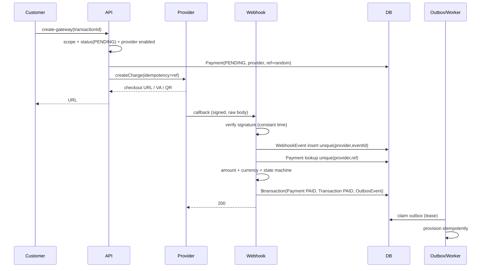

# 16 — SECURITY REMEDIATION BLUEPRINT

**Project:** MVMP (Multi VPN Management Panel)
**Document type:** Security remediation plan — analysis and planning only
**Date:** 2026-11-07
**Input:** `docs/project-analysis/15_INDEPENDENT_AUDIT_VALIDATION.md` (844 lines, 42 claims re-verified, 14 new findings)
**Baseline:** Working tree with the first P0 remediation wave already applied (uncommitted; repository has no `.git`)

> **Status of this document:** PLANNING ONLY.
> No source file, schema, configuration, dependency, migration, or data was modified to produce it.
> All statements about current behaviour were established by reading the tree; no runtime test, build, server start, or database write was performed during this pass.

---

## 0. SCOPE, METHOD, AND BASELINE

### 0.1 What this blueprint covers

The eight areas named in the brief:

1. Cross-tenant data isolation
2. Payment gateway and webhook security
3. VPN credential encryption and protection
4. Session security
5. Authentication and authorization
6. AI emergency shutdown
7. Redis and rate-limiting architecture
8. Background job and provisioning security

### 0.2 Method

1. Read every finding in `15` (§4 SEC-01…SEC-16, §8 API-01…API-05, §9 DB-01…DB-10, §11 NEW-01…NEW-14, §3 ARCH-V1…ARCH-V3).
2. Re-open the current tree and check each cited file at its present state, because a partial P0 wave landed after the audit was written.
3. Search for residual exposure that the audit could not have seen because it predates the P0 patch (new section §3.6).
4. Group remediation into work packages that fix root causes (middleware, guard, repository, crypto layer, worker) rather than individual endpoints.
5. Derive sequencing from dependency direction: identity → authorization → data access → payment/credential → operations.

### 0.3 Baseline corrections relative to report `15`

The audit describes the pre-P0 tree. The following items are **already implemented in the working tree** and must not be rebuilt:

| Item | Evidence in current tree | Verification already performed |
|---|---|---|
| Tenant scoping on customers, VPN accounts, transactions (list + detail) | `src/lib/tenant-scope.ts`; `resolveTenantScope` appears in 7 route files | 15 logic assertions + 11 Prisma/SQLite assertions, all passing |
| Payment webhook signature + amount/currency verification | `src/lib/payment-webhook.ts`; rewritten `payments/webhook/[provider]/route.ts` | 9 signature vectors + 12 route-level assertions (forged 401, mismatch 400, replay idempotent, unconfigured 503) |
| VPN credential AES-256-GCM at rest, masked mirror | `src/lib/credentials.ts`; 4 creation sites migrated | 6 crypto/legacy assertions, all passing |
| Ownership check on `payments/create-gateway` | `resolveTenantScope` + `canAccessTransaction` | covered by scope tests |
| Legacy credential re-encryption script | `scripts/reencrypt-vpn-credentials.ts` | not executed against real data |

**Therefore:** SEC-01, SEC-02, SEC-03, SEC-04, NEW-01, NEW-02 and API-01 are **not open in their original form**. They are reclassified below as `DONE-P0` or `PARTIAL`. Re-implementing them would duplicate work; the blueprint instead closes their residual gaps.

### 0.4 Status legend

| Status | Meaning |
|---|---|
| `DONE-P0` | Implemented in the working tree, unit/integration-verified, **not committed, not E2E-tested, not deployed** |
| `PARTIAL` | Primary exploit closed; bypass, coverage gap, or operational gap remains |
| `OPEN` | No remediation exists |
| `PLANNED` | Addressed by this blueprint, not yet coded |

### 0.5 Verification limits of this planning pass

- No build, no server, no browser, no database, no dependency install.
- Line numbers are cited only where they were re-read during this pass; otherwise file + function/route is given.
- Effort estimates are engineering ranges, not commitments.
- The P0 patch has never run under a real gateway sandbox, so payment conclusions remain code-level.

---

## 1. EXECUTIVE SUMMARY

### 1.1 Where the risk stands now

| Dimension | Audit `15` | After P0 wave | Remaining driver |
|---|---|---|---|
| Cross-tenant isolation | 1/10 | 6/10 | 7 endpoints scoped; dashboard aggregates, server fleet map, realtime bus, notifications still unscoped |
| Payment integrity | 1/10 | 5/10 | Signature/amount closed; no raw event store, no unique reference, no real gateway call, approval still non-atomic |
| Credential protection | 2/10 | 7/10 | AES-GCM + masking done; key rotation, AAD binding, reveal audit, and migration execution absent |
| Authentication | 4/10 | 4/10 | OTP still returned in response; no throttling; no failure audit; timing enumeration |
| Authorization | 3/10 | 5/10 | Tenant scope exists; 100 static role checks still bypass DB RBAC; 3 roles have zero permissions |
| Session security | 3/10 | 3/10 | Plaintext bearer tokens in DB; `SESSION_SECRET` unused; fixed 24 h TTL; no rotation/idle timeout |
| Data integrity | 3/10 | 3/10 | Float money, non-atomic approval, no migrations, random idempotency keys |
| Operability | 6/10 | 6/10 | Compose cannot build; realtime wiring broken; simulator writes production data |
| Testability | 0/10 | 2/10 | Ad-hoc verification scripts only; still no runner, no CI, no committed tests |

**Overall: roughly 5.2/10 — improved from 3.1, still not safe for paying customers or real credentials.**

### 1.2 The ten residual risks that matter most

| Rank | Risk | Why it survives the P0 wave |
|---|---|---|
| 1 | OTP is returned in the API response in every environment | `otp.ts:185` returns `mockOtp: plaintext` unconditionally; route forwards it. Makes 2FA cosmetic and converts any session hijack into permanent takeover |
| 2 | Session tokens stored in plaintext, fixed 24 h, no rotation | A DB read/backup yields live bearer tokens; `SESSION_SECRET` required but never used |
| 3 | No login throttling, lockout, or failure audit | Unlimited credential stuffing; timing enumeration remains |
| 4 | Static RBAC ignores the DB permission matrix | 100 `hasPermission(role,…)` sites; admin UI edits rows nothing enforces; 3 roles have zero permissions |
| 5 | `/api/dashboard` returns platform-wide counts to CUSTOMER/RESELLER | `dashboard.view` is granted to both roles; counts at `dashboard/route.ts:39–41` are unscoped |
| 6 | Realtime bus broadcasts every event to every socket | `mini-services/realtime-service/index.ts`: `io.emit`, CORS `*`, unauthenticated `/emit` on `:3004` |
| 7 | Payment gateway secrets live in a non-sensitive `SystemSetting` row | `settings/providers/route.ts:80` creates with `isSensitive: false`; `/api/settings/system` returns it in bulk |
| 8 | Payment approval and provisioning are non-atomic | `payments/[id]/approve/route.ts`: Payment update, Transaction update, provisioning, email — no transaction boundary |
| 9 | Provisioning is simulated by an admin browser, and the simulator writes production data | `AppShell.tsx` 30 s interval → `simulator/tick` marks jobs SUCCESS with random metrics |
| 10 | Deployment cannot build, and schema has no migration history | Compose `build.context: ..` resolves to `deploy/`; `db:push --accept-data-loss` is the default; PostgreSQL schema lacks `TelegramIntegration` |

### 1.3 Strategy

Five control planes, built in dependency order. Each plane is a **root-cause layer**, not a per-endpoint patch:

```
L1 Identity & Session      → who the caller is, how long, revocable
L2 Authorization kernel    → permission + tenant scope in one guard
L3 Data protection         → credentials, payment secrets, response redaction
L4 Transaction integrity   → webhook event store, state machine, outbox
L5 Operations              → Redis, worker/agent, realtime, deploy, audit
```

Rules that apply to every work package:

- **Fail closed.** Unknown role, unknown provider, missing secret, missing scope → deny, never "allow because development".
- **Scope in the query.** Never fetch-then-filter for lists; never trust a client-supplied `customerId`/`resellerId` as authorisation.
- **404 for foreign resources.** Do not confirm existence to an unauthorised caller.
- **One guard.** No new route may hand-roll `getSessionUser() + hasPermission()`.
- **Every mutation audited**, including failures, with a correlation ID.
- **Secrets never leave the server** and never enter logs, browser storage, job payloads, or bulk settings responses.

---

## 2. REMEDIATION REGISTER — FULL TRACEABILITY

Severity follows report `15`. Status is against the current tree.

### 2.1 Tenant, authorization, session

| ID | Severity | Status | Primary location | Work package |
|---|---|---|---|---|
| SEC-01 | CRITICAL | PARTIAL | `tenant-scope.ts`; 7 routes scoped; `dashboard/route.ts`, `servers/map/route.ts`, `realtime-service` still open | WP-01, WP-02, WP-14 |
| SEC-04 | HIGH | DONE-P0 | `vpn-accounts/[id]/route.ts` asserts scope, strips ciphertext | WP-07 (reveal audit) |
| SEC-06 | HIGH | OPEN | `auth.ts:hasPermission` (100 call sites) vs `rbac.ts:hasPermissionDb` (7 routes) | WP-01 |
| SEC-07 | HIGH | OPEN | `auth/login/route.ts`; `rate-limit.ts` used only by `chat` | WP-03, WP-09 |
| SEC-09 | HIGH | OPEN | `auth.ts:ROLE_PERMISSIONS` (4 keys) vs 7 enum roles | WP-01 |
| SEC-11 | MEDIUM | PARTIAL | Cookie `sameSite:"lax"` only; no Origin/Sec-Fetch-Site check; no `__Host-` | WP-02, WP-15 |
| SEC-12 | HIGH | OPEN | `auth.ts:69–110`: `uuid.uuid`, plaintext `Session.token`, fixed 24 h | WP-02 |
| NEW-08 | HIGH | OPEN | `SESSION_SECRET` validated but never read | WP-02 |
| NEW-11 | MEDIUM | OPEN | Login returns before `bcrypt.compare` for unknown e-mail; no failure audit | WP-03 |
| ARCH-V2 | HIGH | OPEN | No `middleware.ts`; 136 `getSessionUser()` call sites | WP-01 |
| R-01 | HIGH | OPEN | `dashboard/route.ts:39–41` platform-wide counts | WP-01 |

### 2.2 Payment

| ID | Severity | Status | Primary location | Work package |
|---|---|---|---|---|
| SEC-02 | CRITICAL | DONE-P0 | `payment-webhook.ts` + rewritten webhook route | WP-04 (residual) |
| NEW-01 | CRITICAL | DONE-P0 | amount/currency equality in webhook | WP-04 (residual) |
| NEW-02 | CRITICAL | DONE-P0 | `create-gateway` scope assertion | WP-05 |
| API-01 | — | DONE-P0 | same as NEW-02 | WP-05 |
| API-05 | HIGH | OPEN | `payments/[id]/approve/route.ts:46–60` two separate writes | WP-05 |
| NEW-14 | HIGH | OPEN | approval + provisioning not atomic; random idempotency keys | WP-05, WP-11 |
| DB-05 | HIGH | OPEN | `Payment.providerReference` neither unique nor indexed | WP-04 |
| DB-09 | HIGH | OPEN | multi-write flows without transaction boundaries | WP-05, WP-11 |
| SEC-08 | HIGH | OPEN | `settings/providers` row `isSensitive: false`; bulk endpoint returns it | WP-06 |
| NEW-09 | HIGH | OPEN | row auto-created as non-sensitive; never seeded safely | WP-06 |
| R-05 | HIGH | OPEN | webhook has no event store, no unique dedupe, no replay window, no IP/rate control | WP-04 |
| R-06 | MEDIUM | OPEN | provider secrets stored as plaintext JSON inside `SystemSetting.value` | WP-06 |
| R-07 | HIGH | OPEN | `create-gateway` returns a mock checkout URL; no real provider call; no Payment row created when absent | WP-05 |

### 2.3 Credentials

| ID | Severity | Status | Primary location | Work package |
|---|---|---|---|---|
| SEC-03 | CRITICAL | DONE-P0 | `credentials.ts` + 4 creation sites; masked `publicValue` | WP-07, WP-08 |
| R-02 | HIGH | OPEN | no AAD binding, no key id in ciphertext, single global key, no rotation | WP-07 |
| R-03 | MEDIUM | OPEN | credential reveal not audited as its own event; no step-up, no rate limit | WP-07 |
| DB-06 | MEDIUM | OPEN | no `@@unique([serverId, username])` | WP-16 |
| DB-07 | MEDIUM | OPEN | account number from `count()` (`provisioner.ts:133`) | WP-11 |

### 2.4 Auth surface, keys, disclosure

| ID | Severity | Status | Primary location | Work package |
|---|---|---|---|---|
| SEC-05 | HIGH | OPEN | `otp.ts:185`, `security/otp/request/route.ts:57` | WP-03 |
| SEC-10 | HIGH | OPEN | `mini-services/realtime-service/index.ts` | WP-10 |
| SEC-13 | MEDIUM | PARTIAL | `validateDnsResolution` unused in `ai-provider.ts` | WP-15 |
| SEC-14 | MEDIUM | PARTIAL | audit in 65 route files; no wrapper; no retention | WP-15 |
| SEC-15 | MEDIUM | OPEN | no headers in `next.config.ts` | WP-15 |
| SEC-16 | MEDIUM | OPEN | keys issued, never verified | WP-14 |
| NEW-03 | MEDIUM | OPEN | `servers/map` returns hostname/IP/capacity to any session | WP-14 |
| NEW-04 | MEDIUM | OPEN | `api-keys` POST has no permission check | WP-14 |
| API-02 | — | OPEN | same as NEW-03 | WP-14 |
| API-03 | — | OPEN | same as NEW-04 | WP-14 |
| API-04 | MEDIUM | OPEN | unbounded lists (`ai/*`, `notifications`, `servers/map`) | WP-15 |

### 2.5 Infrastructure, jobs, deploy

| ID | Severity | Status | Primary location | Work package |
|---|---|---|---|---|
| ARCH-V1 | CRITICAL (function) | OPEN | `provisioner.ts` → `Job` QUEUED; `worker/index.ts` stub; `mvmp-agent.service` unused | WP-11 |
| ARCH-V3 | HIGH | OPEN | Redis provisioned, API never connects; agent binary never built | WP-09, WP-11 |
| NEW-05 | HIGH | OPEN | `env-validate.ts:41–46` requires `REDIS_URL` for API | WP-09 |
| NEW-06 | MEDIUM | OPEN | `AI_EMERGENCY_SHUTDOWN`, `AI_CHATBOT_ENABLED`, `AI_MAX_*` unread | WP-13 |
| NEW-07 | HIGH | OPEN | `AppShell.tsx` interval → `simulator/tick` writes production data | WP-12 |
| NEW-10 | HIGH | OPEN | `TelegramIntegration` absent from PostgreSQL schema | WP-16 |
| NEW-12 | HIGH | OPEN | compose context/ports/path broken; no realtime URL | WP-16 |
| NEW-13 | HIGH | OPEN | `db:push --accept-data-loss`; no `prisma/migrations` | WP-16 |
| DB-01 | CRITICAL | OPEN | schema drift (Telegram) | WP-16 |
| DB-02 | CRITICAL | OPEN | no migration history | WP-16 |
| DB-03 | HIGH | OPEN | money as `Float` | WP-16 |
| DB-04 | MEDIUM | OPEN | 20 free-text status fields | WP-16 |
| DB-08 | MEDIUM | OPEN | ledger has no FK to transaction | WP-16 |
| DB-10 | MEDIUM | OPEN | audit/metric/usage tables unbounded | WP-15 |

### 2.6 Newly identified in this pass (post-P0 residuals)

| ID | Severity | Finding | Evidence |
|---|---|---|---|
| R-01 | HIGH | Dashboard aggregates leak platform scale (customers, resellers, transaction count, revenue) to CUSTOMER/RESELLER | `dashboard/route.ts` checks only `dashboard.view`, then `db.customer.count()`, `db.reseller.count()`, `db.transaction.count()` |
| R-02 | HIGH | Credential ciphertext is not bound to its row or field; identical plaintexts produce different ciphertexts, but a ciphertext copied between rows still decrypts | `crypto.ts` AES-GCM without AAD; `credentials.ts` passes no context |
| R-03 | MEDIUM | Reveal has no dedicated audit/permission/rate limit; `vpn_accounts.view` alone is sufficient | `vpn-accounts/[id]/route.ts`, `portal/customer/my-accounts/[id]/config/route.ts` |
| R-04 | MEDIUM | `create-gateway` only updates an existing Payment; when none exists it returns a URL that no webhook can resolve | `create-gateway/route.ts` (`if (existingPayment)`) |
| R-05 | HIGH | Webhook idempotency depends solely on `Payment.status`; a second event with a different payload is silently acknowledged | route returns `alreadyProcessed` whenever status is PAID |
| R-06 | MEDIUM | Provider secrets are plaintext inside `SystemSetting.value`; masking is presentation-only | `settings/providers/route.ts` stores JSON as-is |
| R-07 | HIGH | Gateway integration is a mock; the response advertises `mode` and a sandbox URL as if live | `create-gateway/route.ts` comment + `mockPaymentUrl` |
| R-08 | MEDIUM | Session revocation is per-token only; no "revoke all devices" except password change; no session list | `auth.ts` |
| R-09 | MEDIUM | `resolveTenantScope` walks the reseller tree with up to 5 sequential queries per request, no cache, no depth error | `tenant-scope.ts` |
| R-10 | MEDIUM | No correlation ID; 120 handlers collapse errors to `INTERNAL` without a request identifier | audit `15` §8.3 |

---

## 3. PHASE 1 — DETAILED FINDING TRACEABILITY

Each row carries the six required dimensions. "Side effect" means the collateral change a fix can cause to existing behaviour.

### 3.1 Identity, session, authorization

| ID | Files / functions / endpoints | Dependencies | Impact | Possible side effects of the fix |
|---|---|---|---|---|
| SEC-05 | `src/lib/otp.ts` (`requestOtp`, line 185 `mockOtp`), `api/security/otp/request/route.ts:57`, `api/security/change-password`, `api/security/otp/verify` | `mailer.ts`, `auditLog`, `SystemSetting` OTP config | OTP is not a factor. A stolen session can change the password without the old one, then own the account permanently | Removing `mockOtp` breaks the dev UI that displays it; tests and manual QA need a mail-catcher or a `NODE_ENV==="test"` accessor; users without working SMTP cannot complete OTP flows |
| SEC-07 / NEW-11 | `api/auth/login/route.ts` (whole handler), `lib/rate-limit.ts`, `lib/auth.ts:verifyPassword` | `bcryptjs`, Redis (absent), `security.login_max_attempts` setting (unused) | Unlimited credential stuffing; timing oracle for registered e-mails; no failure trail | Legitimate users behind NAT share an IP budget; lockout can be abused to deny service; adding Redis creates a new hard dependency; dummy-hash compare adds ~100 ms per unknown login |
| SEC-12 / NEW-08 / R-08 | `lib/auth.ts:69–110` (`createSession`, `getSessionUser`, `destroySession`), `api/auth/logout`, `api/auth/me`, `prisma.Session` | `uuid`, `cookies()`, `SESSION_SECRET` (unused), `SESSION_TTL_HOURS` (unused), `general.session_timeout_minutes` (unused) | DB read → live token. Fixed 24 h, no rotation, no idle timeout, no device list | Hashing tokens invalidates every existing session at deploy unless dual-read is shipped; `__Host-` prefix requires HTTPS and breaks plain-HTTP dev; shorter TTL annoys long-running admin sessions; IP binding breaks mobile networks |
| SEC-06 / SEC-09 | `lib/auth.ts:ROLE_PERMISSIONS`, `lib/rbac.ts:getUserPermissions/hasPermissionDb`, 100 call sites, `RolePermissionMatrix.tsx`, `scripts/seed.ts` roles/permissions | Prisma `Role`, `Permission`, `RolePermission`, `UserPermission`; UI matrix | Admin revokes a permission; API ignores it. OPERATOR/FINANCE/CUSTOMER_SERVICE authenticate but get 403 everywhere; seeded `ops@mvmp.id` unusable; ADMIN cannot save settings | Switching to DB checks adds 1 query per request (mitigated by cache); if seed is incomplete, staff lock themselves out; SUPER_ADMIN must stay unconditional; permission cache must be invalidated on role edit |
| SEC-01 residual / R-01 / SEC-04 | `dashboard/route.ts:39–41`; `tenant-scope.ts`; `customers/*`, `vpn-accounts/*`, `transactions/*`; `portal/*` | `tenant-scope.ts`, Prisma relations, `resolveTenantScope` | Aggregate business metrics leak to tenants; original PII leak already closed on 7 endpoints | Scoping dashboard changes numbers shown to staff-like roles; RESELLER sees only subtree; cached TanStack data must be invalidated; performance cost of scoped counts |
| ARCH-V2 / R-09 | absent `src/middleware.ts`; 136 `getSessionUser()` sites; `tenant-scope.ts` BFS | Next.js middleware, `cookies()`, Prisma | Every new route is one forgotten guard away from a breach; reseller scope costs up to 6 queries | A global middleware that redirects unauthenticated users breaks webhook/public routes; middleware cannot use Prisma on the edge runtime; central guard changes 401/403 bodies and may break client error handling; scope caching can serve stale access after a reseller move |
| SEC-11 | cookie creation `auth.ts:125–148`; every mutation route | browser cookie policy; reverse proxy | SameSite=Lax mitigates classic CSRF by accident; same-site XSS/subdomain becomes full takeover; no `__Host-` | Adding Origin checks breaks legitimate cross-origin admin tools and mobile webviews; `SameSite=Strict` breaks e-mail deep links; `__Host-` breaks HTTP deployments |
| API-03 / NEW-04 / SEC-16 | `api/api-keys/route.ts` POST (no permission), `api/api-keys/[id]/route.ts`; absent verifier | `crypto` hash, `ApiKey` model, `api_keys.manage` seed | Any role can mint keys with arbitrary scope strings; nothing verifies them, so users trust a dead credential | Gating issuance can break an existing UI flow; implementing a verifier widens the public attack surface and needs its own rate limit and revocation UX |

### 3.2 Payment

| ID | Files / functions / endpoints | Dependencies | Impact | Possible side effects of the fix |
|---|---|---|---|---|
| SEC-02 / NEW-01 / R-05 | `api/payments/webhook/[provider]/route.ts` (rewritten), `lib/payment-webhook.ts`, `lib/credentials.ts`-independent | `SystemSetting payment.providers`, `crypto` HMAC, `Payment`, `Transaction`, `auditLog` | Forged/replayed callbacks and amount tampering now rejected; but no event store means dedupe is status-based only, and payloads are not retained | Adding a `WebhookEvent` table and unique indexes requires a migration and a backfill/dedupe pass; rejecting unknown statuses may cause provider retries; strict amount comparison can fail on provider formatting (`1000` vs `1000.00`) |
| NEW-02 / API-01 / R-04 / R-07 | `api/payments/create-gateway/route.ts` | `resolveTenantScope`, `canAccessTransaction`, `Payment`, provider config, `uuid` | Ownership closed. But the handler still returns a mock URL, does not create a Payment when missing, and lets a client learn a reference before the gateway knows it | Creating the Payment row up-front changes the invoice state machine; real provider calls introduce timeouts, idempotency keys, and failure states; existing sandbox UI expects `checkout.<provider>.sandbox.com` |
| API-05 / NEW-14 / DB-09 | `api/payments/[id]/approve/route.ts` (Payment update then Transaction update, then provisioning), `reject` route, `provisioner.ts` | Prisma `$transaction`, `provisionPackageForCustomer`, mailer, realtime | PAID Payment without PAID Transaction if the second write fails; provisioning can fail after money is recognised; retry duplicates accounts | Wrapping in `$transaction` holds a DB transaction during provisioning (slow, lock risk) unless fulfilment moves to an outbox; changing approval semantics may break the "approve anyway" operator workflow; duplicate-account prevention needs a deterministic key |
| DB-05 | `prisma/schema.prisma` `Payment` (`providerReference String?`, index only on status/transactionId) | Postgres partial unique index; SQLite limitations | `findFirst` can match the wrong payment when references collide or are attacker-chosen | A unique index fails on existing duplicates; needs a dedupe report and a remediation path; nullable columns need a partial index in Postgres and a sentinel in SQLite |
| SEC-08 / NEW-09 / R-06 | `api/settings/providers/route.ts:71–92` (creates `isSensitive:false`), `api/settings/system/route.ts` (returns all non-sensitive rows), `settings` UI | `SystemSetting`, `crypto.ts`, `settings.view/manage` | Live gateway secrets returned in bulk to ADMIN and to any browser network log | Marking the row sensitive hides it from the settings UI that edits it; splitting secrets requires a new table and migration; rotating keys requires provider dashboards |
| R-05 | webhook route: no `payloadHash` persistence, no `(provider,eventId)` uniqueness, no timestamp window | `Payment`, provider payload formats | Same invoice can be acknowledged with a different body; forensic reconstruction impossible | Storing raw payloads increases PII/secret surface (must encrypt/redact); a timestamp window may reject legitimate delayed retries |

### 3.3 Credentials

| ID | Files / functions / endpoints | Dependencies | Impact | Possible side effects of the fix |
|---|---|---|---|---|
| SEC-03 / R-02 / R-03 | `lib/credentials.ts`, `lib/crypto.ts:117–186`, `provisioner.ts:176–183`, `api/vpn-accounts/create`, `api/portal/reseller/create-account`, `scripts/seed.ts`, `scripts/reencrypt-vpn-credentials.ts`, `vpn-accounts/[id]`, `portal/.../config` | `AI_ENCRYPTION_KEY`, AES-256-GCM, `VpnCredential.keyVersion` | Secrets now encrypted and masked; but ciphertext is not bound to its row (swap attack), one global key, no rotation, reveal not separately audited | Adding AAD changes ciphertext format → all rows need re-encryption; a key-id format (`v2:`) requires dual-read; revoking old keys before backfill loses credentials; masking `publicValue` may break UI that expected a copyable value |
| DB-06 / DB-07 | `VpnAccount` model (no `@@unique([serverId, username])`), `provisioner.ts:133` `db.vpnAccount.count()` | Postgres unique constraint, sequence/counter table | Duplicate usernames per server; concurrent provisioning duplicates account numbers and collides on the agent | Unique constraint requires cleanup of existing duplicates; a counter table introduces a new write hotspot; changing numbering breaks printed invoices/config references |

### 3.4 Infrastructure, realtime, jobs

| ID | Files / functions / endpoints | Dependencies | Impact | Possible side effects of the fix |
|---|---|---|---|---|
| SEC-10 | `mini-services/realtime-service/index.ts` (CORS `*`, `io.emit`, `/emit` on 3004), `lib/realtime.ts`, `RealtimeBridge.tsx:36`, `notify.ts` | socket.io, session cookie, `REALTIME_EMIT_URL` | Every socket receives every tenant's events; anyone reaching 3004 can inject UI notifications | Authenticating the handshake requires cookie forwarding/CORS credentials; room refactor changes client event handling; requiring an internal token breaks deployments that lack the env var until compose is fixed |
| NEW-05 / ARCH-V3 | `lib/env-validate.ts:41–46`, `instrumentation.ts`, `worker/index.ts`, `rate-limit.ts`, `deploy/docker/docker-compose.yml` | ioredis/BullMQ, Redis ACLs | API refuses to boot without Redis it never uses; rate limiting is per-process memory, one route only | Making Redis required at runtime adds a failure mode; in-memory fallback hides misconfiguration; changing validation can let a misconfigured production boot |
| NEW-06 / AI shutdown | `ai-provider.ts:348`, `api/chat/route.ts:56`, `api/ai/*`, `AICenterView.tsx`, compose env, `.env.production.example` | `AiConfig` model, env, cache | Env kill switch does nothing; only chat honours the DB flag; agent/suggestions bypass it | Honouring env over DB can surprise operators; a cached flag delays shutdown by seconds; failing closed on config errors breaks AI during DB blips |
| NEW-07 / ARCH-V1 | `AppShell.tsx:305–310`, `api/simulator/tick/route.ts` (no `NODE_ENV` guard), `provisioner.ts` job creation, `worker/index.ts`, `mvmp-agent.service` | Prisma `Job`, `ServerMetric`, `VpnAccount` | Random metrics, fake job success, accounts marked ACTIVE with no configuration written; without an admin tab, provisioning never completes | Removing the simulator exposes that provisioning is non-functional; production guard breaks demos; cleanup must distinguish simulated rows from real ones |
| NEW-12 / NEW-13 / NEW-10 / DB-01 / DB-02 | `deploy/docker/docker-compose.yml:102` context `..`, port `3005:3003`, no `REALTIME_EMIT_URL`; `deploy/nginx/mvmp.conf:104` `/socket.io/` vs socket path `/`; `prisma/schema.postgres.prisma` (no Telegram); `package.json db:push` | Docker, nginx, Prisma migrate | Container build fails; realtime no-ops in Docker; Telegram fails at runtime in Postgres; any deploy can drop columns | Fixing context changes image layout; switching to `migrate deploy` needs a baseline of the live schema; adding Telegram requires a migration and a UI retest |
| SEC-13 / SEC-15 / SEC-14 / DB-10 / API-04 | `lib/ssrf.ts`, `lib/ai-provider.ts` (DNS check unused), `next.config.ts` (no headers), 65 audit call sites, `audit-logs` route, list routes | `dns/promises`, Next headers, Postgres | DNS rebinding TOCTOU; missing CSP/HSTS when nginx is bypassed; no forensic trail for key operations; unbounded tables and lists | Pinning resolved IPs breaks legitimate CDN/redirects; a strict CSP breaks inline styles/scripts in the current SPA; retention deletion is irreversible; pagination changes break clients that expect full arrays |

---

## 4. PHASE 2 — SECURITY DESIGN

### 4.A Tenant isolation

#### A.1 Principal and scope model

```ts
// Design contract (not code to be written yet)
type Principal = {
  userId: string;
  role: UserRole;
  permissions: Set<PermissionKey>; // resolved from DB, cached <=10s
  scope: TenantScope;              // all | reseller | customer | none
  sessionId: string;
};

type TenantScope =
  | { kind: "all" }
  | { kind: "reseller"; resellerId: string; subtreeIds: string[] }
  | { kind: "customer"; customerId: string }
  | { kind: "none" };
```

Resolution rules (authoritative, no exceptions):

| Role | Scope | Source of truth |
|---|---|---|
| SUPER_ADMIN, ADMIN, OPERATOR, FINANCE, CUSTOMER_SERVICE | `all` | role |
| RESELLER | `reseller` + subtree | `Reseller.userId`, closure/CTE over `parentResellerId` |
| CUSTOMER | `customer` | `Customer.userId` |
| any other / missing profile | `none` | fail closed |

#### A.2 Enforcement layers

1. **Edge gate (middleware):** reject unauthenticated requests to `/api/*` except an explicit allow-list (`auth/login`, `payments/webhook/*`, `api/health`). Middleware performs no Prisma query; it only checks cookie presence and redirects. It is an optimisation, never the authorization decision.
2. **Route guard:** `withAuth({ permission }, handler)` resolves the principal once per request (React `cache()`), then enforces permission. All 139 handlers migrate; the 100 static role checks are deleted.
3. **Scope injection:** list handlers call `scope.where(model)`; detail handlers call `assertResourceAccess(principal, resource)` which throws a 404 envelope.
4. **Query shape:** every scope fragment is combined with `AND`, never `OR`. Client-supplied `customerId`, `resellerId`, `status`, `search` are filters **after** the scope, never instead of it.
5. **Nested reads:** a `Transaction` include of `customer` is safe only because the parent query is scoped. Any endpoint that starts from the child (e.g. `Payment`) must join to the owning `Transaction → Customer`.

#### A.3 Resource ownership matrix

| Resource | Owner path | Detail assertion | List filter |
|---|---|---|---|
| Customer | `Customer.id` / `userId` / `resellerId` | 404 | `id = scope.customerId` or `resellerId IN subtree` |
| VpnAccount | `customerId → Customer` | 404 | `customerId = ...` / `customer.resellerId IN ...` |
| VpnCredential | `vpnAccountId → VpnAccount.customerId` | 404 + permission `vpn_accounts.reveal` | never listed |
| Transaction | `customerId` | 404 | `customerId` / `customer.resellerId` |
| Payment | `transactionId → Transaction.customerId` | staff only (`payments.verify`) | staff only; no tenant list today |
| Reseller | `Reseller.id` / `parentResellerId` | staff or self | staff: all; reseller: own record only |
| Notification | `userId` | 404 | `userId = principal.userId` |
| Server / Job / Metric | staff `servers.view` / `monitoring.view` | 403/404 | staff only; customers get an aggregate, region-level projection |
| AuditLog | staff `audit.view` | 403 | staff only |

#### A.4 Reseller subtree

Current `tenant-scope.ts` performs 1 + up to 5 sequential queries per request. Target:

- **Postgres:** recursive CTE (`WITH RECURSIVE subtree AS …`) executed once, or a maintained closure table `ResellerClosure(ancestorId, descendantId, depth)` updated on reseller create/move.
- **SQLite dev:** BFS fallback, same interface.
- **Cache:** `reseller-subtree:{id}` for 60 s, invalidated on reseller create/move/delete.
- **Depth:** hard cap 10, explicit error above it (never silently truncate).
- **Cycle protection:** reject a move that would create a cycle.

#### A.5 Negative authorization test cases (mandatory)

| # | Actor | Action | Expected |
|---|---|---|---|
| N1 | Customer A | `GET /api/customers` | only A's row |
| N2 | Customer A | `GET /api/customers/{B}` | 404 |
| N3 | Customer A | `GET /api/vpn-accounts/{B}` | 404 |
| N4 | Customer A | `GET /api/transactions/{B}` | 404 |
| N5 | Customer A | `POST /api/payments/create-gateway` with B's transaction | 404 |
| N6 | Customer A | `GET /api/dashboard` | scoped counts (own), no platform totals |
| N7 | Reseller R1 | list customers | R1 subtree only, not R2 (sibling) |
| N8 | Reseller R2 | `GET` R1's customer by ID | 404 |
| N9 | Reseller R2 | list VPN accounts | subtree only |
| N10 | Reseller R1 | request parent's transaction | 404 |
| N11 | Customer A | `GET /api/servers/map` | aggregate projection only, no hostname/IP |
| N12 | Customer A | `GET /api/audit-logs` | 403 |
| N13 | Customer A | `PATCH /api/users/{self}` role change | 403 |
| N14 | Customer A | socket handshake | joins only own room; receives no other tenant event |
| N15 | Reseller R1 | customer in R2 (same parent) | 404 (no lateral access) |
| N16 | Staff FINANCE | `/api/customers` | all rows, read-only (no manage permission) |
| N17 | Deleted customer's session | any scoped endpoint | `none` scope → 404 |

### 4.B Payment security

#### B.1 Target flow



#### B.2 Signature matrix

| Provider | Mechanism | Input | Comparison | Failure |
|---|---|---|---|---|
| Xendit | Callback token header | `x-callback-token` vs `xendit.webhookToken` | `timingSafeEqual` | 401 |
| Midtrans | SHA-512 | `order_id + status_code + gross_amount + serverKey` vs `signature_key` | constant time, lowercase hex | 401 |
| DOKU | HMAC-SHA256 | raw body, `doku.sharedKey` | constant time | 401 |
| iPaymu | HMAC-SHA256 | raw body, `ipaymu.apiKey` | constant time | 401 |
| Any | missing secret | — | — | **503 fail closed** |

Additional controls:

- Read the **raw body once** and verify before parsing status (`req.text()` then `JSON.parse`); never re-serialise for HMAC.
- Reject bodies above a fixed limit (e.g. 256 KB) to prevent memory abuse.
- Store the verdict (`signatureOk`, `reason`) with the event.
- Provider-specific event id (`body.id`, `transaction_id`, `order_id + status_code`, `trx_id`) is required for dedupe; if absent, derive a hash of the raw body and mark the event `unverifiable-dedupe` for alerting.

#### B.3 Amount, currency, and status

- Money comparison in **minor units** (integer). `Transaction.amount` and `Payment.amount` migrate to `Decimal(18,2)` (DB-03); until then compare `Math.round(value * 100)`.
- Currency must equal `Payment.currency` (ISO-4217, uppercase). Missing currency → reject.
- Only transitions from `PENDING` are accepted: `PENDING → PAID`, `PENDING → EXPIRED`, `PENDING → FAILED`.
- `PAID` is terminal. A later `PAID` with a different payload is **not** silently accepted: record it as a conflicting event, keep payment PAID, alert.
- A late `PAID` for an `EXPIRED` payment requires an explicit reconciliation endpoint (`payments.verify` + audit), never an automatic flip.
- Provider status mapping is an explicit allow-list per provider, not a string passthrough.

#### B.4 Idempotency and replay

New model (additive):

```prisma
model PaymentWebhookEvent {
  id               String   @id @default(cuid())
  provider         String
  providerEventId  String?
  providerReference String?
  payloadHash      String
  payloadEncrypted String   // AES-GCM, retention 90 days
  signatureOk      Boolean
  amountMinor      BigInt?
  currency         String?
  status           String?
  processedAt      DateTime?
  result           String?  // PROCESSED | DUPLICATE | IGNORED | CONFLICT
  createdAt        DateTime @default(now())

  @@unique([provider, providerEventId])
  @@index([provider, providerReference])
  @@index([createdAt])
}
```

Plus `@@unique([provider, providerReference])` on `Payment` (nullable → partial unique index in Postgres).

- Duplicate event → 200 `alreadyProcessed`, no mutation.
- Same reference, different payload hash → `CONFLICT`, alert, no mutation.
- Optional timestamp window (±10 min) when the provider sends `created_at`/`transaction_time`; outside window → 400 `STALE_EVENT`.
- Webhook route is rate-limited per IP and per provider (Redis), with burst allowance for provider retries.

#### B.5 Audit trail

Every callback writes an append-only record with: provider, event id, reference, amount, currency, verdict, resulting state, duration, request id, source IP (hashed if policy requires). Payload is encrypted; card/VA numbers and customer e-mail are redacted in logs.

#### B.6 Secrets

- Provider credentials move out of `SystemSetting.value` into `PaymentProviderCredential` (or an encrypted `Secret` table): `provider`, `field`, `ciphertext`, `keyVersion`, `updatedAt`, `updatedBy`.
- `SystemSetting` keeps only non-secret metadata (`enabled`, `mode`, `label`).
- Bulk settings endpoints never return secrets; the providers endpoint returns `{ configured: true, maskedSuffix }`.
- Only `settings.manage` + step-up (password or OTP) can rotate a secret; rotation is audited.

### 4.C VPN credential security

#### C.1 Envelope format v2

```
v2:<keyId>:<nonce-hex>:<tag-hex>:<ciphertext-hex>
AAD = "<vpnAccountId>|<credentialType>|<keyId>"
```

- AES-256-GCM, 12-byte nonce, 16-byte tag (current primitives are sound).
- Key id enables rotation without re-encrypting everything at once.
- AAD prevents moving a ciphertext from one account/field to another (closes R-02).
- `publicValue` becomes a mask only (`ab••••••yz`) or is dropped; no cleartext mirror.
- Add `secretFingerprint` = HMAC-SHA256(secret, server key) for support correlation without revealing the secret.

#### C.2 Key management

| Stage | Now | Target |
|---|---|---|
| Key source | `AI_ENCRYPTION_KEY` env (32 bytes), dev fallback derived from `DATABASE_URL` | Secret manager / KMS; env only injects a reference or wrapped DEK |
| Key count | 1 | keyring: active + previous, `keyId` in ciphertext |
| Rotation | manual, no tooling | `scripts/rotate-credential-key.ts`: decrypt with old, encrypt with new, batched, resumable, verifies count |
| Startup | validates presence in production | validates active key + previous key format; fails closed |
| Compromise | re-key everything | rotate KEK, re-encrypt all v2 rows, revoke VPN credentials and force re-issue |

#### C.3 Retrieval and redaction

- `GET` list endpoints never select `secretEncrypted`/`publicValue`; DTO allow-list only.
- `GET /api/vpn-accounts/[id]` returns metadata only (no secret), even for staff.
- New `POST /api/vpn-accounts/[id]/reveal` (or reuse config route) requires:
  - scope ownership (customer/reseller) **or** `vpn_accounts.reveal` for staff,
  - rate limit (e.g. 10/min per user),
  - `Cache-Control: no-store`, `Pragma: no-cache`,
  - audit `CREDENTIAL_REVEALED` with actor, account, purpose,
  - optional step-up OTP for staff bulk reveal.
- `shownOnceAt` set on first reveal; UI shows a one-time warning.
- No secret in any log, error message, analytics event, or realtime payload.

#### C.4 Migration strategy

1. Add `keyVersion` semantics and `v2:` reader (dual-read: `v2:` → v1 → legacy Base64).
2. Dry-run script over all rows; report counts by format and any undecryptable rows (never print secrets).
3. Backfill in batches of 500 with a checkpoint; each batch is a transaction.
4. Verify: total rows == decrypted rows; sample decrypt of 1% via a checksum.
5. Switch writes to `v2:` only; keep v1 reader for 30 days.
6. Revoke/rotate any credential that cannot be decrypted; notify the owner.
7. Remove legacy reader after the window.

#### C.5 Backward compatibility

- Existing configs already issued with `publicValue` must keep working: `revealCredential()` prioritises legacy `publicValue` for pre-migration rows (already implemented). Do not change that ordering until the backfill completes.
- After backfill, `publicValue` contains only a mask; reveal always decrypts.
- UI that displayed `publicValue` switches to the reveal endpoint; otherwise users see a mask where they expect a password.

### 4.D Session security

#### D.1 Token design

| Property | Current | Target |
|---|---|---|
| Entropy | two UUIDv4 concatenated (~244 bits) | 32 random bytes, base64url (256 bits) |
| Storage | plaintext `Session.token` | `tokenHash = SHA-256(token)`, unique |
| Lookup | equality on token | hash then equality |
| Cookie | `mvmp_session`, `HttpOnly`, `SameSite=Lax`, `Secure` in prod | `__Host-mvmp_session` in production; `Secure`, `HttpOnly`, `SameSite=Lax`, `Path=/` |
| TTL | hard-coded 24 h | absolute TTL from `general.session_timeout_minutes` (default 8 h) + idle timeout 30 min |
| Rotation | none | rotate on login, privilege change, password change |
| Revocation | per-token `revokedAt` | per-token + `User.sessionEpoch` bump to revoke all |
| Device visibility | none | session list with IP/UA/last-seen; revoke individual/all |
| Fixation | new token per login (already) | delete previous token for the same device fingerprint |

#### D.2 Validation pipeline

1. Cookie present → hash → lookup by `tokenHash` (dual-read during migration).
2. `revokedAt` null, `expiresAt > now`, `lastSeenAt > now - idleTimeout`.
3. `user.status === "ACTIVE"`, `user.sessionEpoch === session.epoch`.
4. Update `lastSeenAt` at most once per minute (avoid a write per request).
5. Return principal; permission resolution is separate (cached ≤10 s).

#### D.3 CSRF and cookie hardening

- Validate `Origin`/`Sec-Fetch-Site` on every mutation; allow same-origin and configured admin origins only.
- Reject `text/plain` and form-encoded bodies on JSON endpoints.
- `__Host-` prefix (no `Domain`, `Path=/`, `Secure`) in production.
- Optional double-submit token for high-risk actions (settings, secret rotation, user role change).

#### D.4 Migration and rollback

- Add `tokenHash` nullable + `epoch` default 0 → dual-read (hash first, then plaintext) → backfill hashes → enforce → drop plaintext column in a later release.
- Rollback: keep plaintext column until the enforce step; reverting code restores old behaviour without logging users out.

### 4.E Infrastructure security

#### E.1 Redis: decide, then use it

**Decision:** use Redis as the shared rate-limit and lock backend; stop pretending it is an API dependency before that code exists.

| Concern | Design |
|---|---|
| Client | one singleton `ioredis` in `src/lib/redis.ts`, lazy connect, `maxRetriesPerRequest`, bounded reconnect |
| Rate limit | Lua sliding window, key `rl:{scope}:{subject}:{window}`, returns `{allowed, remaining, retryAfter}` |
| Failure policy | login/OTP/payment/AI → fail closed (503); read-only lists → fail open + warn metric |
| Config | read `RATE_LIMIT_*` env; no hard-coded numbers |
| Sessions | optional read-through cache; never the source of truth |
| Locks | `SET NX PX` for provisioning/webhook dedupe; lease renewal |
| Env validation | `REDIS_URL` required only when `RATE_LIMIT_BACKEND=redis` (production default); worker always requires it |
| Observability | latency, error rate, fallback count exposed in `/api/health` |

Rate-limit matrix:

| Surface | Key | Limit (default) | Failure mode |
|---|---|---|---|
| Login | IP + account | 5/min, 20/hour, lockout 15 min after 10 failures | closed |
| OTP request | user + IP | 3/10 min | closed |
| OTP verify | user | 5/10 min | closed |
| Password change | user | 5/hour | closed |
| create-gateway | user | 10/min | closed |
| Webhook | IP + provider | 120/min burst 300 | closed with 429 |
| Chat / AI | user | env-driven | closed |
| API keys | key id | per scope | closed |

#### E.2 Worker and agent architecture

- **Outbox**: `OutboxEvent(id, type, payload, status, attempts, availableAt, lockedBy, lockedAt)` written in the same transaction as the state change.
- **Producer**: outbox dispatcher enqueues BullMQ jobs with a deterministic `jobId` (`provision:{transactionId}:{protocolId}`) so duplicates collapse.
- **Consumer**: worker claims with a lease, validates payload schema, decrypts credential only inside the worker, calls the agent, records `JobLog`, retries with backoff, moves to dead-letter after N attempts.
- **Agent protocol**: per-server token or mTLS; request signed with HMAC(timestamp + nonce + body); replay window; agent refuses unsigned commands; commands are idempotent and validated against a whitelist.
- **Job payload**: no plaintext credentials, no secrets, only IDs and non-sensitive parameters.
- **Authorization**: no user-facing endpoint may enqueue arbitrary job types; only server-side services do.
- **Observability**: job age, failure rate, stuck leases; alert when `QUEUED` age > 5 min.

#### E.3 Realtime

- Handshake ticket: API issues `HMAC(userId|exp|rooms)` short-lived token; socket server verifies before join.
- Rooms: `user:{id}`, `tenant:reseller:{id}`, `staff:{permission}`; **never** `io.emit`.
- Emit endpoint: bind loopback, require `X-Internal-Token` (HMAC of body + timestamp), reject unsigned.
- CORS: explicit origin allow-list, `credentials: true`.
- Client: subscribe to rooms implicitly from the session; on `reconnect`, refetch authoritative state (do not trust missed events).

#### E.4 AI emergency shutdown

Single function, evaluated per request (cache ≤5 s):

```
aiEnabled =
  !env.AI_EMERGENCY_SHUTDOWN &&
  env.AI_CHATBOT_ENABLED !== "false" &&
  !dbConfig.emergencyShutdown &&
  dbConfig.chatbotEnabled !== false
```

- Env **overrides** DB (documented), so an operator can stop spending during an incident without a DB write.
- Every entry point calls it: chat, AI agent, suggestions, provider test, Telegram bot, model listing.
- When disabled: 200 with a fixed refusal message for user-facing chat (no provider call), 503 for internal/agent endpoints.
- Toggling writes an audit entry with actor and source (env vs DB).
- `/api/health` exposes `{ ai: "enabled" | "disabled", source }`.
- Token budgets: enforce `AI_MAX_INPUT_TOKENS` / `AI_MAX_OUTPUT_TOKENS` before the call; reject oversize input; per-user daily quota.
- Fail closed if config cannot be read (do not default to enabled).

#### E.5 Deployment correctness

| Defect | Fix |
|---|---|
| compose `build.context: ..` resolves to `deploy/` | `../..` or move compose to repo root; explicit `dockerfile: ../../Dockerfile` |
| API lacks `REALTIME_EMIT_URL` | `http://realtime:3004/emit` |
| Published `127.0.0.1:3005:3003` vs nginx `3003` | publish `127.0.0.1:3003:3003` or update upstream |
| nginx `/socket.io/` vs socket `path:"/"` | align both (recommend socket path `/socket.io/`) |
| `db:push --accept-data-loss` default | `prisma migrate deploy` in entrypoint; forbid push in prod |
| PostgreSQL schema drift | single schema source; generate Postgres via migrations; add Telegram model |
| systemd agent points at non-existent binary | remove unit or ship the agent; make the unit fail loudly |
| Redis required by API but unused | fix validation per E.1 |

---

## 5. PHASE 3 — DEPENDENCY AND IMPACT ANALYSIS

### 5.1 Component blast radius

| Component | Changes that touch it | Breakage risk | Required safeguard |
|---|---|---|---|
| Admin dashboard | Scoped aggregates, RBAC switch, session TTL, 404 semantics | Medium | Staff scope stays `all`; verify totals unchanged for SUPER_ADMIN; snapshot tests on numbers |
| Customer portal | Scope, reveal endpoint, session, OTP, payment | High | Keep response envelope; reveal returns same config text as before; E2E per flow |
| Reseller portal | Subtree scope, commissions, create-account, credentials | High | Subtree fixtures; R1/R2/sibling tests; commission totals unchanged |
| VPN provisioning | Credential v2, job/outbox, agent, account numbering | Very high | Feature flag; dual-read; canary server; idempotent job keys |
| Payment gateway | Webhook v2, real adapters, secrets vault, approval atomicity | Very high | Sandbox credentials; replay/concurrency tests; provider retry behaviour |
| AI | Kill switch, token budgets, SSRF pinning | Medium | Env override documented; refusal message stable; config cache short |
| WhatsApp | Notifications, rate limit, realtime payloads | Low | Mock remains; no secret in payload |
| Telegram | Postgres schema, kill switch | Medium | Add model + migration; integration test against Postgres |
| Realtime | Auth handshake, rooms, emit token, compose URL | High | Two-browser E2E; graceful fallback when service down |
| API contracts | 404 vs 403, new error codes, pagination, headers | Medium | Additive error codes; document; client tolerates unknown codes |
| Deploy | Compose, nginx, migrations, env | High | Staging deploy + rollback drill before production |

### 5.2 Database impact

| Change | Type | Destructive? | Backfill | Rollback |
|---|---|---|---|---|
| `Session.tokenHash` + `epoch` | additive columns | No | compute hashes | drop columns after enforce; keep plaintext until then |
| `PaymentWebhookEvent` | new table | No | none | drop table |
| `Payment @@unique(provider, providerReference)` | index | Fails on duplicates | dedupe report first | drop index |
| `PaymentProviderCredential` | new table | No | move secrets from JSON | keep JSON until verified |
| `VpnCredential` `v2:` format + `secretFingerprint` | data rewrite | No (ciphertext only) | batched re-encrypt | keep v1 reader + encrypted backup |
| `Decimal(18,2)` money | type change | Risky | add new columns, dual write, backfill | keep float columns until switch |
| `ResellerClosure` | new table | No | build from adjacency | drop table |
| `OutboxEvent` | new table | No | none | drop table |
| `TelegramIntegration` (Postgres) | new table | No | none | drop table |
| `VpnAccount @@unique(serverId,username)` | index | Fails on duplicates | dedupe report | drop index |
| `Job` lease columns | additive | No | defaults | drop columns |

### 5.3 API contract impact

- **Preserved:** `{ success, data | error: { code, message } }` envelope, pagination on customers/vpn/transactions, existing field names.
- **Changed:** out-of-scope detail returns **404** instead of 200/403; 401 vs 403 semantics standardised; new codes (`SESSION_EXPIRED`, `RATE_LIMITED`, `STALE_EVENT`, `CONFLICT`, `STEP_UP_REQUIRED`).
- **Added:** reveal endpoint, session management endpoints, webhook event audit (staff), health details.
- **Removed:** `mockOtp` from every environment; secrets from `/api/settings/system`; ciphertext from VPN detail.
- **Deprecated:** direct `publicValue` reads (mask only after backfill).

### 5.4 UI impact

| Screen | Impact |
|---|---|
| Login | lockout message, rate-limit countdown, no behaviour change on success |
| OTP modal | no on-screen code; "check your e-mail/WhatsApp" state; resend timer |
| Account detail | secret hidden behind "reveal" with confirmation and one-time notice |
| Settings → Providers | shows `configured/masked`, rotate action with step-up |
| Dashboard | scoped numbers for reseller/customer; no platform totals |
| Sessions | new device list and "revoke all" |
| AI Center | kill-switch state and source; disabled banner |
| Payments | real checkout URL; pending/expired states; no fake success |
| Realtime | no visible change if rooms work; reconnect refresh |

---

## 6. PHASE 4 — IMPLEMENTATION BLUEPRINT

Each work package is self-contained and ends with tests + acceptance. Estimates are person-days for one senior engineer.

### WP-01 — Authorization kernel and residual tenant scoping

| # | Field | Content |
|---|---|---|
| 1 | Current state | `resolveTenantScope` exists and 7 routes use it. 100 sites use static `hasPermission(role,…)`. No middleware. `/api/dashboard` returns platform-wide counts to CUSTOMER/RESELLER. Reseller subtree is 1–6 sequential queries. |
| 2 | Problem | Authorization is per-file and role-static; DB permission matrix is decorative; aggregates leak business scale; scope logic is duplicated and can drift. |
| 3 | Target | One `getPrincipal()` + `withAuth()` used by every route; permissions from DB with static fallback only as seed; scoped dashboard; subtree resolved once per request. |
| 4 | Solution | Add `src/lib/principal.ts` (resolve user, permissions, scope, cache per request), `src/lib/with-auth.ts` (permission + handler), `src/lib/scope-repo.ts` (`where` builders + `assertAccess`). Migrate routes in batches, deleting static checks. Implement subtree CTE/closure + 60 s cache. Scope dashboard counts by principal. |
| 5 | Files changed | `src/lib/auth.ts`, `src/lib/rbac.ts`, `src/lib/tenant-scope.ts`, `src/app/api/dashboard/route.ts`, 7 scoped routes, all routes with `hasPermission(user.role,…)`, `src/app/api/servers/map/route.ts` |
| 6 | New files | `src/lib/principal.ts`, `src/lib/with-auth.ts`, `src/lib/scope-repo.ts`, `src/middleware.ts` |
| 7 | DB impact | Optional `ResellerClosure`; no destructive change |
| 8 | API impact | 404 for foreign resources; standard 401/403; dashboard numbers scoped |
| 9 | UI impact | Reseller/customer dashboard shows own scale; admin unchanged |
| 10 | Security impact | Removes the class of "forgot the guard"; closes R-01 and SEC-01 residual |
| 11 | Migration | No data migration required for the guard; closure backfill if adopted |
| 12 | Rollback | Feature flag `AUTH_KERNEL=legacy|new`; old guards remain until parity tests pass |
| 13 | Unit tests | Scope fragment for all 4 scope kinds; permission resolution (role, grant, deny, SUPER_ADMIN); subtree depth/cycle |
| 14 | Integration | N1–N17 matrix; staff totals unchanged; reseller subtree correctness; performance budget (<50 ms overhead) |
| 15 | E2E | Customer A cannot open B's account/customer/transaction URL; reseller sees subtree only |
| 16 | Acceptance | 0 `hasPermission(user.role` outside `rbac.ts`/seed; 100% of `/api/**` behind `withAuth` or explicit public allow-list; N1–N17 green |

### WP-02 — Session hardening

| # | Field | Content |
|---|---|---|
| 1 | Current state | `uuid+uuid` token stored plaintext; fixed 24 h; `SESSION_SECRET` unread; cookie `mvmp_session`, SameSite Lax; no rotation/idle/device list. |
| 2 | Problem | DB/backup read yields live sessions; no revocation at scale; TTL setting ignored; secret gives false assurance. |
| 3 | Target | 256-bit token, SHA-256 at rest, `__Host-` cookie, configurable absolute + idle TTL, rotation, epoch revocation, device management. |
| 4 | Solution | Add `tokenHash`, `epoch`, `lastSeenAt`; `createSession` returns raw token, stores hash; `getSessionUser` hashes and dual-reads; rotate on login/privilege change; settings-driven TTL; session endpoints. |
| 5 | Files changed | `src/lib/auth.ts`, `src/app/api/auth/{login,logout,me}`, `security/change-password`, `users/[id]/reset-password`, `env-validate.ts` |
| 6 | New files | `src/app/api/auth/sessions/route.ts`, `src/app/api/auth/sessions/[id]/route.ts` |
| 7 | DB impact | `Session.tokenHash` unique nullable, `epoch Int @default(0)`, `lastSeenAt`; backfill hashes |
| 8 | API impact | New session list/revoke; `SESSION_EXPIRED` code; logout idempotent |
| 9 | UI impact | Active sessions panel; re-login after deploy only if dual-read omitted |
| 10 | Security impact | Closes SEC-12/NEW-08/R-08; stolen DB no longer authenticates |
| 11 | Migration | Expand → dual-read → backfill → enforce → drop plaintext (two releases) |
| 12 | Rollback | Keep plaintext column and dual-read until enforce; revert code = old sessions still valid |
| 13 | Unit | Hash/lookup, TTL absolute/idle, epoch mismatch, rotation invalidates old token |
| 14 | Integration | Login → cookie flags → me → logout; revoke-all; password change revokes others; concurrent sessions |
| 15 | E2E | Two browsers; revoke one; idle timeout; `__Host-` present in production build |
| 16 | Acceptance | No plaintext token column after enforce; cookie flags verified; TTL follows setting; revoke-all works |

### WP-03 — Login and OTP hardening

| # | Field | Content |
|---|---|---|
| 1 | Current state | Login has no rate limit/lockout/failure audit; unknown e-mail returns before bcrypt. OTP response always contains `mockOtp` (`otp.ts:185`); change-password needs only OTP. |
| 2 | Problem | Credential stuffing, enumeration, and a 2FA that returns its own code to the attacker. |
| 3 | Target | Constant-time login, per-IP+account throttling, lockout, failure audit; OTP never in a response outside `NODE_ENV=test`; real delivery or OTP flows disabled. |
| 4 | Solution | Dummy bcrypt hash for unknown users; Redis counters + lockout; audit `LOGIN_FAILED`; remove `mockOtp` from type/route; SMTP/WhatsApp delivery with a dev mail-catcher; require old password or step-up for change-password; resend limits. |
| 5 | Files changed | `api/auth/login/route.ts`, `lib/otp.ts`, `api/security/otp/{request,verify}`, `api/security/change-password`, `lib/mailer.ts` |
| 6 | New files | `src/lib/login-guard.ts`, test mail sink |
| 7 | DB impact | `LoginAttempt` table (or audit-only); `User.lockedUntil`, `failedLoginCount` |
| 8 | API impact | 429 with `Retry-After`; `ACCOUNT_LOCKED`; no `mockOtp` |
| 9 | UI impact | Countdown, lockout message, OTP "sent" state |
| 10 | Security impact | Closes SEC-05/SEC-07/NEW-11 |
| 11 | Migration | Add columns with defaults; no backfill |
| 12 | Rollback | Feature flag for lockout; OTP removal is not rollback-safe (intentional) |
| 13 | Unit | Dummy-hash timing, counter increments, lockout expiry, OTP payload shape |
| 14 | Integration | 10 failed logins → lock; unknown vs known timing within tolerance; OTP not in JSON; change-password requires step-up |
| 15 | E2E | Full login + OTP + change password with mail sink |
| 16 | Acceptance | `mockOtp` absent from all responses (grep + contract test); 429 after threshold; failure audited |

### WP-04 — Payment webhook v2 (event store, uniqueness, replay)

| # | Field | Content |
|---|---|---|
| 1 | Current state | Signature + amount + currency verified; state machine guarded; idempotency inferred from `Payment.status`; no raw payload, no unique reference, no event id, no rate limit. |
| 2 | Problem | Replay/conflict handling is implicit; wrong-payment resolution possible on reference collision; no forensic record; provider retries can race. |
| 3 | Target | Every callback persisted exactly once, signature verdict recorded, unique `(provider,eventId)`, unique `(provider,reference)`, explicit conflict handling, concurrency-safe transitions. |
| 4 | Solution | Add `PaymentWebhookEvent`; compute payload hash; insert before mutation with unique catch; `updateMany({where:{status:"PENDING"}})` for transitions; store encrypted payload 90 days; add per-IP/provider rate limit; return provider-specific 200/400 semantics. |
| 5 | Files changed | `api/payments/webhook/[provider]/route.ts`, `lib/payment-webhook.ts`, `prisma/schema.prisma`, `schema.postgres.prisma` |
| 6 | New files | `src/lib/payment/events.ts`, `src/lib/payment/state.ts` |
| 7 | DB impact | New table + unique index on Payment; dedupe report before index |
| 8 | API impact | New codes `DUPLICATE_EVENT`, `CONFLICT`, `STALE_EVENT`; still 200 on duplicate |
| 9 | UI impact | None directly; admin payment detail can show event trail (optional) |
| 10 | Security impact | Closes R-05, DB-05; strengthens SEC-02 |
| 11 | Migration | Additive table; index after cleanup; encrypt payload from day one |
| 12 | Rollback | Drop table/index; route falls back to status-only logic (feature flag) |
| 13 | Unit | Hash, dedupe, state transitions, amount minor units, currency, provider mapping |
| 14 | Integration | Two parallel valid callbacks → one PAID, one duplicate; forged/replay/stale; 1-IDR mismatch; collision on ref |
| 15 | E2E | Sandbox provider callback (or signed fixture) → invoice PAID once |
| 16 | Acceptance | Exactly one state change per event under concurrency; every callback persisted; conflicts alerted |

### WP-05 — Payment lifecycle, real gateway adapters, atomic approval

| # | Field | Content |
|---|---|---|
| 1 | Current state | `create-gateway` returns a mock URL, updates an existing Payment only, no provider call; approval writes Payment then Transaction then provisions, non-atomically. |
| 2 | Problem | Product cannot take real payments; partial states (PAID payment, PENDING transaction) and duplicate provisioning are possible. |
| 3 | Target | Adapter interface with real sandbox/production calls; Payment created up-front with idempotency key; approval and fulfilment atomic via outbox. |
| 4 | Solution | `PaymentGateway` interface (`createCharge`, `verify`, `mapStatus`); provider adapters; persist `providerReference` before returning URL; `$transaction` for Payment+Transaction+Outbox; worker fulfils; reconciliation endpoint for EXPIRED→PAID. |
| 5 | Files changed | `create-gateway`, `payments/[id]/approve`, `reject`, `payments/[id]/route`, `lib/provisioner.ts` |
| 6 | New files | `src/lib/payment/gateway.ts`, `providers/{xendit,midtrans,doku,ipaymu}.ts`, `src/lib/payment/outbox.ts` |
| 7 | DB impact | `OutboxEvent`; `Payment.idempotencyKey` unique; money Decimal |
| 8 | API impact | Real `paymentUrl`/VA/QR; `PROVIDER_ERROR`; idempotent create |
| 9 | UI impact | Real checkout redirect; pending/expired states; no fake success |
| 10 | Security impact | Closes R-04/R-07/API-05/NEW-14 |
| 11 | Migration | Add outbox + columns; no destructive step |
| 12 | Rollback | `PAYMENT_ADAPTER=mock` flag restores old behaviour |
| 13 | Unit | Adapter request/response mapping, idempotency, amount formatting |
| 14 | Integration | Create → pay sandbox → webhook → PAID → provisioning once; approval failure rolls back all; retry no duplicates |
| 15 | E2E | Customer checkout with sandbox provider; reseller sees commission |
| 16 | Acceptance | No partial PAID state under injected failure; duplicate approve produces one provisioning set |

### WP-06 — Payment secret vault

| # | Field | Content |
|---|---|---|
| 1 | Current state | `payment.providers` JSON contains `apiKey/serverKey/sharedKey/webhookToken` plaintext; row created `isSensitive:false`; `/api/settings/system` returns it. |
| 2 | Problem | Live gateway credentials exposed to ADMIN browsers and any non-sensitive bulk read. |
| 3 | Target | Secrets encrypted at rest with key id; metadata-only settings; masked read; step-up rotation. |
| 4 | Solution | `PaymentProviderCredential` table (`ciphertext`, `keyVersion`); providers GET returns `{configured, suffix}`; PATCH writes via vault; system settings filters the row; step-up + audit on rotate. |
| 5 | Files changed | `settings/providers/route.ts`, `settings/system/route.ts`, `lib/payment-webhook.ts` (read from vault), `lib/payment/*` |
| 6 | New files | `src/lib/secrets.ts` |
| 7 | DB impact | New table; migrate JSON values; mark old row sensitive |
| 8 | API impact | No secret in any response; `configured` booleans |
| 9 | UI impact | Providers page shows masked state + rotate dialog |
| 10 | Security impact | Closes SEC-08/NEW-09/R-06 |
| 11 | Migration | Read JSON → encrypt → verify → clear JSON secret fields (keep metadata) |
| 12 | Rollback | Keep JSON copy in an encrypted maintenance row until verified |
| 13 | Unit | Vault encrypt/decrypt, masking, rotation versioning |
| 14 | Integration | Settings bulk never contains secret; webhook verifies using vault secret; rotation invalidates old |
| 15 | E2E | Admin rotates key; old key rejected; new callback accepted |
| 16 | Acceptance | Grep of API responses shows zero secret fields; `isSensitive` true for the metadata row |

### WP-07 — Credential crypto v2, AAD, reveal control

| # | Field | Content |
|---|---|---|
| 1 | Current state | AES-GCM `v1:` with no AAD; `publicValue` masked; reveal on account detail and config route; no dedicated audit/rate limit. |
| 2 | Problem | Ciphertext is portable between rows; key rotation impossible without downtime; reveal is under-controlled. |
| 3 | Target | `v2:keyId:nonce:tag:ciphertext` with AAD; keyring; dedicated reveal endpoint with permission, rate limit, audit, no-store. |
| 4 | Solution | Extend `crypto.ts` with AAD + keyring; `buildCredentialFields(secret, ctx)`; `revealCredential(cred, ctx)`; add reveal route; strip secrets from detail; `secretFingerprint`. |
| 5 | Files changed | `lib/crypto.ts`, `lib/credentials.ts`, `provisioner.ts`, 4 creation sites, `vpn-accounts/[id]`, `portal/.../config` |
| 6 | New files | `src/lib/keyring.ts`, `src/app/api/vpn-accounts/[id]/reveal/route.ts` |
| 7 | DB impact | `secretFingerprint` column; ciphertext rewrite (WP-08) |
| 8 | API impact | Detail no longer returns secret; new reveal endpoint; 404 for foreign |
| 9 | UI impact | Reveal button + one-time warning; masked value otherwise |
| 10 | Security impact | Closes R-02/R-03; strengthens SEC-03/04 |
| 11 | Migration | Dual-read v2/v1/legacy; writes v2 only |
| 12 | Rollback | Keep v1 reader; revert writes to v1 (not recommended) |
| 13 | Unit | AAD mismatch fails, key id selection, fingerprint, mask |
| 14 | Integration | Ciphertext moved between rows fails; reveal audit; rate limit 429; no-store headers |
| 15 | E2E | Customer reveals own config; staff reveal audited; foreign 404 |
| 16 | Acceptance | Swap attack fails in test; no secret in list/detail JSON; reveal audited |

### WP-08 — Credential migration and key rotation

| # | Field | Content |
|---|---|---|
| 1 | Current state | `scripts/reencrypt-vpn-credentials.ts` exists, idempotent, never executed; legacy Base64/plaintext rows may remain. |
| 2 | Problem | Unmigrated rows keep weak storage; no rotation runbook or verification. |
| 3 | Target | 100% v2 rows, verifiable, with a rehearsed rotation procedure. |
| 4 | Solution | Dry-run report (counts by format, decrypt failures), batched backfill with checkpoints, checksum verification, rotation script with active+previous keys, runbook. |
| 5 | Files changed | `scripts/reencrypt-vpn-credentials.ts` |
| 6 | New files | `scripts/rotate-credential-key.ts`, `docs/runbooks/credential-rotation.md` |
| 7 | DB impact | Data rewrite only |
| 8 | API impact | None |
| 9 | UI impact | None |
| 10 | Security impact | Removes legacy weak storage; enables key compromise response |
| 11 | Migration | Dry run → backup → batch → verify → retire v1 |
| 12 | Rollback | Restore encrypted backup; keep previous key in keyring |
| 13 | Unit | Batch resume, idempotency, decrypt failure classification |
| 14 | Integration | Fixture DB with v1/legacy/v2 rows → 100% v2; counts match |
| 15 | E2E | Issue config before and after migration; both work |
| 16 | Acceptance | 0 rows outside v2; rotation completes with zero decrypt failures |

### WP-09 — Redis and distributed rate limiting

| # | Field | Content |
|---|---|---|
| 1 | Current state | Redis used only by worker/diagnostics; API requires `REDIS_URL` but never connects; in-memory limiter on chat only; `RATE_LIMIT_*` unread. |
| 2 | Problem | Brute force and cost abuse are unthrottled; horizontal scaling multiplies budgets; false production dependency. |
| 3 | Target | Shared Redis limiter across all sensitive surfaces; env-driven limits; correct API/worker requirements. |
| 4 | Solution | Singleton client, Lua sliding window, per-surface policies, fail-open/closed matrix, health metrics; validation split. |
| 5 | Files changed | `lib/rate-limit.ts`, `lib/env-validate.ts`, `instrumentation.ts`, `api/auth/login`, `api/security/otp/*`, `api/payments/create-gateway`, `api/chat`, webhook |
| 6 | New files | `src/lib/redis.ts`, `src/lib/rate-limit-redis.ts` |
| 7 | DB impact | None |
| 8 | API impact | 429 + `Retry-After`; 503 on closed-surface Redis outage |
| 9 | UI impact | Rate-limit messages |
| 10 | Security impact | Closes NEW-05 and enables SEC-07 |
| 11 | Migration | None |
| 12 | Rollback | `RATE_LIMIT_BACKEND=memory` (single instance only) |
| 13 | Unit | Lua window math, key isolation, retry-after |
| 14 | Integration | Two app instances share budget; Redis down behaviour per surface |
| 15 | E2E | Login brute force → 429; AI chat budget |
| 16 | Acceptance | Budgets identical across instances; env values honoured; no false boot failure |

### WP-10 — Realtime authentication, rooms, emit protection

| # | Field | Content |
|---|---|---|
| 1 | Current state | CORS `*`, no handshake auth, `io.emit` to all, `/emit` unauthenticated on 3004, client path `/?XTransformPort=3003`. |
| 2 | Problem | Cross-tenant notification leakage; event injection into operator UI. |
| 3 | Target | Authenticated handshake, tenant/user rooms, signed internal emit, explicit CORS, compose wiring. |
| 4 | Solution | Short-lived HMAC ticket issued by API; socket verifies and joins rooms; `io.to(room)`; emit requires timestamped HMAC; bind loopback; client reconnect refetch. |
| 5 | Files changed | `mini-services/realtime-service/index.ts`, `lib/realtime.ts`, `RealtimeBridge.tsx`, `lib/notify.ts`, calls to `broadcast` (room target) |
| 6 | New files | `src/app/api/realtime/ticket/route.ts`, `mini-services/realtime-service/auth.ts` |
| 7 | DB impact | None |
| 8 | API impact | Ticket endpoint; broadcast payload adds `room` |
| 9 | UI impact | Reconnect refresh; no visual change otherwise |
| 10 | Security impact | Closes SEC-10; removes tenant leakage via socket |
| 11 | Migration | Deploy service+API together; old clients get no events (acceptable) |
| 12 | Rollback | Keep `ALLOW_LEGACY_BROADCAST=true` for one release |
| 13 | Unit | Ticket HMAC/expiry, room derivation, emit signature |
| 14 | Integration | Two users, two tenants: no cross-delivery; unsigned emit 401; expired ticket rejected |
| 15 | E2E | Two browser contexts receive only own notifications |
| 16 | Acceptance | 0 `io.emit` global; unsigned emit rejected; CORS allow-list |

### WP-11 — Provisioning worker, outbox, job security, agent

| # | Field | Content |
|---|---|---|
| 1 | Current state | Provisioner writes `Job` QUEUED; worker is a no-op stub; simulator marks jobs SUCCESS; no agent; account number from `count()`; random idempotency keys. |
| 2 | Problem | Provisioning is not real; jobs are unverified; duplicates and fabricated state corrupt billing and inventory. |
| 3 | Target | Durable outbox → worker → signed agent; idempotent jobs; real status; no simulator. |
| 4 | Solution | Outbox table + dispatcher; BullMQ producer with deterministic jobId; lease/attempts/dead-letter; agent protocol with HMAC/mTLS; credential decrypted only in worker; account numbering via sequence; unique `(serverId, username)`. |
| 5 | Files changed | `lib/provisioner.ts`, `worker/index.ts`, `api/jobs/route.ts`, `api/payments/[id]/approve`, schema |
| 6 | New files | `src/lib/outbox.ts`, `src/worker/provision-consumer.ts`, `agent/` (Go, out of repo build) |
| 7 | DB impact | Outbox, job lease columns, sequence/counter, unique index |
| 8 | API impact | Job status truthful; approval returns "queued"; no fake success |
| 9 | UI impact | Progress states, retry, error reasons |
| 10 | Security impact | Closes ARCH-V1, DB-06/07/09, NEW-14 fulfilment |
| 11 | Migration | Additive; cleanup of simulated rows (tagged) |
| 12 | Rollback | Disable outbox dispatcher; jobs remain QUEUED (explicit, not fake) |
| 13 | Unit | Idempotency key, lease expiry, retry/backoff, payload validation |
| 14 | Integration | Approve → outbox → job → agent stub → ACTIVE; crash mid-job → retry once; duplicate approve → one set |
| 15 | E2E | Real/staging server provisioning with agent; failure surfaces error |
| 16 | Acceptance | No success without agent acknowledgement; exactly-once per (transaction, protocol) |

### WP-12 — Remove the production simulator

| # | Field | Content |
|---|---|---|
| 1 | Current state | `AppShell` calls `simulator/tick` every 30 s for admins; route has no environment guard; writes metrics, job status, account status. |
| 2 | Problem | Fabricated operational and financial data; provisioning "works" only while a browser tab is open. |
| 3 | Target | Simulator cannot run in production; demo data is seeded explicitly; no client-driven writes. |
| 4 | Solution | Server guard `NODE_ENV==="production"` → 404; require `ALLOW_SIMULATOR=true`; SUPER_ADMIN + audit; remove interval from production bundle; tag simulated rows for cleanup. |
| 5 | Files changed | `api/simulator/tick/route.ts`, `AppShell.tsx`, `next.config.ts` (env), docs |
| 6 | New files | `scripts/seed-demo-metrics.ts` (optional) |
| 7 | DB impact | Cleanup/flag simulated rows |
| 8 | API impact | 404 in production |
| 9 | UI impact | No ticking demo data in production |
| 10 | Security impact | Closes NEW-07 |
| 11 | Migration | Delete/tag demo rows in production |
| 12 | Rollback | Temporary `ALLOW_SIMULATOR=true` for staging only |
| 13 | Unit | Guard matrix |
| 14 | Integration | Production env → 404; dev+flag → allowed |
| 15 | E2E | Admin cannot fake job success in production build |
| 16 | Acceptance | Production bundle contains no simulator interval; route 404 without flag |

### WP-13 — AI kill switch and budgets

| # | Field | Content |
|---|---|---|
| 1 | Current state | DB `emergencyShutdown` honoured only by chat; env `AI_EMERGENCY_SHUTDOWN`/`AI_CHATBOT_ENABLED`/`AI_MAX_*` unread. |
| 2 | Problem | Operators cannot stop AI spend during an incident; safety control is cosmetic. |
| 3 | Target | Single evaluated flag for every AI entry point, env > DB, audited, exposed in health. |
| 4 | Solution | `ai-runtime.ts` with 5 s cache; check in chat/agent/suggestions/test/telegram; token budgets; fail closed on config error. |
| 5 | Files changed | `lib/ai-provider.ts`, `api/chat`, `api/ai/*`, `api/telegram/*`, `api/ai/config` |
| 6 | New files | `src/lib/ai-runtime.ts` |
| 7 | DB impact | Optional `configVersion` for cache invalidation |
| 8 | API impact | 503/refusal when disabled; `ai` state in health |
| 9 | UI impact | Banner with source (env/DB) |
| 10 | Security impact | Closes NEW-06 |
| 11 | Migration | None |
| 12 | Rollback | Remove env override (DB still works) |
| 13 | Unit | Precedence matrix, cache expiry, budgets |
| 14 | Integration | Env off → all endpoints refuse; DB off → all refuse; toggle audited |
| 15 | E2E | Admin toggles; next chat refuses |
| 16 | Acceptance | Grep shows every AI entry point calls the guard; no provider call when off |

### WP-14 — API keys and infrastructure disclosure

| # | Field | Content |
|---|---|---|
| 1 | Current state | Any role can mint keys with arbitrary scopes; no verifier. `/api/servers/map` returns hostname/IP/capacity to any session. |
| 2 | Problem | Dead credentials users may trust; fleet topology disclosure. |
| 3 | Target | Keys gated + verified + scoped, or removed; server map staff-only with a safe aggregate for customers. |
| 4 | Solution | `api_keys.manage` gate, scope allow-list, SHA-256 verifier middleware, expiry/lastUsedAt/revoke; `servers/map` requires `servers.view`; customer projection omits hostname/IP. |
| 5 | Files changed | `api/api-keys/*`, `api/servers/map/route.ts`, `lib/auth.ts` permissions |
| 6 | New files | `src/lib/api-key-auth.ts`, `src/lib/server-projection.ts` |
| 7 | DB impact | `ApiKey.lastUsedAt`, `revokedAt` (existing fields reused) |
| 8 | API impact | 403 for non-managers; 401 for invalid key; customer map shape changes |
| 9 | UI impact | API keys page for permitted roles; map view hides internals |
| 10 | Security impact | Closes SEC-16/NEW-03/NEW-04/API-02/API-03 |
| 11 | Migration | Revoke keys with unknown scopes |
| 12 | Rollback | Feature flag to disable key auth |
| 13 | Unit | Hash lookup, scope check, expiry |
| 14 | Integration | Customer cannot mint; key works for allowed scope; foreign scope 403; map projection |
| 15 | E2E | API key round-trip; customer map has no hostname |
| 16 | Acceptance | No key without permission; verifier covered by tests; no IP in customer response |

### WP-15 — Transport, SSRF, audit, pagination

| # | Field | Content |
|---|---|---|
| 1 | Current state | No app-level security headers; no Origin check; DNS validation unused in chat path; audit coverage uneven; no retention; unbounded lists. |
| 2 | Problem | Missing defence in depth; DNS rebinding; weak forensics; memory/latency growth. |
| 3 | Target | Headers everywhere, Origin enforcement, pinned DNS, mutation audit wrapper, retention job, pagination contract. |
| 4 | Solution | `next.config.ts headers()`; `security.ts` origin check; resolve+pin IP and re-check redirects; `withAudit()` wrapper; retention cron; `page/limit` with max on all lists. |
| 5 | Files changed | `next.config.ts`, mutation routes, `lib/ssrf.ts`, `lib/ai-provider.ts`, `audit-logs`, list routes |
| 6 | New files | `src/lib/http-security.ts`, `src/lib/audit.ts`, `scripts/prune-audit-logs.ts` |
| 7 | DB impact | None; retention deletes by age |
| 8 | API impact | `X-Request-Id`, headers; pagination required |
| 9 | UI impact | Lists load pages; no break if defaults applied |
| 10 | Security impact | Closes SEC-11 residual/SEC-13/SEC-14/SEC-15/API-04/DB-10 |
| 11 | Migration | None |
| 12 | Rollback | Header removal safe; pagination flag |
| 13 | Unit | Origin matrix, IP pinning, retention cutoff |
| 14 | Integration | Foreign Origin 403; headers present; audit on failure; list caps |
| 15 | E2E | CSRF attempt blocked; headers in response |
| 16 | Acceptance | 0 mutation without audit; headers on all responses; no unbounded list |

### WP-16 — Schema, migrations, deploy correctness

| # | Field | Content |
|---|---|---|
| 1 | Current state | No migrations; `db:push --accept-data-loss`; Postgres schema lacks Telegram; compose context/ports/path broken; money Float; free-text statuses; ledger no FK. |
| 2 | Problem | Destructive deploys, environment drift, broken container build, financial rounding. |
| 3 | Target | Reviewed migrations, single schema source, working compose, Decimal money, enum-validated statuses, ledger FK. |
| 4 | Solution | Baseline migration from live schema; `migrate deploy` in entrypoint; delete duplicate schema or generate it; fix compose/nginx; money expand/contract; status validation map; add FK. |
| 5 | Files changed | `prisma/*`, `package.json`, `deploy/docker/docker-compose.yml`, `deploy/nginx/mvmp.conf`, `Caddyfile`, systemd units, `env-validate.ts` |
| 6 | New files | `prisma/migrations/*`, `scripts/baseline-check.ts` |
| 7 | DB impact | Additive first; money type change is the risky step |
| 8 | API impact | None if validation accepts existing values |
| 9 | UI impact | Status fields constrained; no free text |
| 10 | Security impact | Prevents data loss and prod drift |
| 11 | Migration | Expand → backfill → contract; rehearsed on a copy |
| 12 | Rollback | Restore backup; migrations are forward-only, so rehearse |
| 13 | Unit | Money conversion, status validation |
| 14 | Integration | Migrate empty + legacy copy; compose build; Telegram CRUD on Postgres |
| 15 | E2E | Deploy staging from scratch; rollback drill |
| 16 | Acceptance | `docker compose build` passes; `migrate deploy` clean; no `--accept-data-loss` in prod path |

### WP-17 — Test harness and CI

| # | Field | Content |
|---|---|---|
| 1 | Current state | 0 automated tests, no runner, no CI, no typecheck script; `ignoreBuildErrors: true`. |
| 2 | Problem | Every fix is unverifiable and regression-prone; the P0 wave was validated by ad-hoc scripts only. |
| 3 | Target | Vitest unit/integration, Playwright E2E, Postgres test DB, CI gates. |
| 4 | Solution | Add runner + config, factories, auth fixtures, DB per worker, route-handler harness; CI: typecheck, lint, unit, integration, build, E2E smoke, migration check. |
| 5 | Files changed | `package.json`, `next.config.ts` (remove ignoreBuildErrors), `eslint.config.mjs` |
| 6 | New files | `vitest.config.ts`, `playwright.config.ts`, `tests/**`, `.github/workflows/ci.yml` |
| 7 | DB impact | Test-only database |
| 8 | API impact | None |
| 9 | UI impact | None |
| 10 | Security impact | Makes every control regression-tested |
| 11 | Migration | None |
| 12 | Rollback | CI advisory first, blocking after stabilisation |
| 13 | Unit | Scope, crypto, signature, state machine, rate limit |
| 14 | Integration | Tenant matrix, webhook concurrency, approval atomicity |
| 15 | E2E | Login, payment sandbox, reveal, realtime isolation |
| 16 | Acceptance | CI green on main; coverage gates (auth/payment ≥90%); no build error suppression |

---

## 7. PHASE 5 — PRIORITY AND SEQUENCING

### 7.1 Priority

| Priority | Work packages | Rationale |
|---|---|---|
| **P0 — before any external user** | WP-17a (harness), WP-01, WP-02, WP-03, WP-04, WP-06, WP-12, WP-16a (migrations + compose + Telegram) | Account takeover paths (OTP, session), brute force, payment event integrity, live gateway secrets, fabricated production data, destructive deploy |
| **P1 — closed beta** | WP-05, WP-07, WP-08, WP-09, WP-10, WP-11, WP-13, WP-14, WP-17b (E2E/CI) | Real payments, key rotation, distributed limits, cross-tenant realtime, real provisioning, operational AI control, key/fleet exposure |
| **P2 — hardening** | WP-15, WP-16b (Decimal/enums/FK), pagination, audit retention, API-key verifier polish | Defence in depth, forensics, financial correctness at scale |
| **P3 — sustainability** | Component splitting, dependency cleanup, OpenAPI, formatter, lint strictness | Maintainability, not immediate risk |

### 7.2 Dependency order

```
Wave 0 (week 1)
  WP-17a harness ──┬─> WP-01 auth kernel ──> WP-02 sessions
                   └─> WP-16a migrations baseline (parallel, schema only)
Wave 1 (weeks 2–3)
  WP-01 ──> WP-03 login/OTP
  WP-01 ──> dashboard/servers scoping (part of WP-01/WP-14)
  WP-16a ──> WP-06 secret vault
  WP-12 simulator off (independent)
Wave 2 (weeks 3–5)
  WP-01 + WP-04 ──> WP-05 payment lifecycle/adapters
  WP-07 ──> WP-08 credential migration/rotation
  WP-09 Redis (needed by WP-03 lockout and webhook limits; start in wave 1)
Wave 3 (weeks 5–8)
  WP-11 outbox/worker/agent (XL; spike in week 1)
  WP-10 realtime (depends on WP-01 principal + WP-09)
  WP-14 API keys/fleet
Wave 4 (weeks 8–10)
  WP-13 AI guard, WP-15 transport/audit, WP-16b money/schema, WP-17b CI/E2E
```

Critical path: **WP-01 → WP-04/WP-05 → WP-11** (authorization → payment truth → fulfilment). WP-17 runs throughout.

### 7.3 Explicit non-goals

- No microservice split, no event-sourcing rewrite, no UI redesign.
- No new VPN protocol or agent feature work beyond what fulfilment requires.
- No WAF/CDN purchase decisions (deployment concern outside this repo).
- No migration to a different ORM or auth library.

---

## 8. TEST PLAN

### 8.1 Unit (Vitest, no DB)

| Area | Cases |
|---|---|
| Scope | 4 scope kinds, subtree depth, sibling isolation, unknown role, missing profile |
| Permission | role grant, user GRANT, user DENY precedence, SUPER_ADMIN immunity, cache invalidation |
| Signature | Xendit token equal/different/length mismatch; Midtrans SHA-512 vector; DOKU/iPaymu HMAC; missing secret; malformed header |
| Payment state | every allowed/denied transition, amount minor units, currency, duplicate event, conflict hash |
| Credentials | encrypt/decrypt, AAD mismatch, key id, mask, fingerprint, legacy ordering |
| Sessions | hash, expiry, idle, epoch, rotation |
| Rate limit | window math, isolation, retry-after, failure policy |
| AI guard | env/DB precedence, cache, budgets |
| Money | Float→Decimal conversion, rounding, currency |

### 8.2 Integration (Vitest + Postgres, route handlers invoked directly)

Fixtures: 1 super admin, 1 admin, 1 finance, 1 operator, 1 CS, R1 with R2 child, R3 sibling, C1 under R1, C2 under R2, C3 direct, C4 under R3; accounts, credentials, transactions, payments, jobs.

| Suite | Assertions |
|---|---|
| Tenant matrix | N1–N17; staff totals unchanged; reseller subtree correct; 404 not 403 |
| Sessions | login/logout/me/revoke/idle/epoch; cookie flags; no plaintext lookup after enforce |
| Login/OTP | lockout, 429, no `mockOtp`, change-password step-up |
| Webhook | forged 401, amount 400, currency 400, valid 200, duplicate 200 no-op, conflict flagged, concurrency (10 parallel) one PAID |
| Payment lifecycle | create → pay → webhook → PAID → one outbox; injected failure rolls back; retry no duplicates |
| Credentials | v1/legacy/v2 fixtures, swap attack fails, reveal audit, rate limit, no-store |
| Realtime | ticket verify, room isolation, unsigned emit 401 |
| Jobs | enqueue, lease expiry, retry, dead-letter, duplicate collapse |
| Settings | bulk response has no secrets; rotation invalidates old |
| Deploy | migrate empty + copy; compose build smoke (CI job) |

### 8.3 E2E (Playwright)

1. Customer login → dashboard shows own numbers only.
2. Customer A pastes B's account URL → 404 page, no data flash.
3. Customer buys package → sandbox gateway → callback → account ACTIVE (stub agent) → config reveal works once.
4. Reseller logs in → sees C1/C2 subtree, not R3's customer.
5. Admin approves manual payment → exactly one provisioning set; retry idempotent.
6. Two browser contexts → notification appears only in the target tenant.
7. Admin enables AI kill switch → next chat refuses without a provider call.
8. Session revoke-all → other browser is logged out on next request.
9. OTP flow with mail sink → no code displayed in UI.

### 8.4 Security-specific

| Test | Expected |
|---|---|
| Foreign `Origin` mutation | 403 |
| Missing CSRF token (if enabled) | 403 |
| Webhook replay 10× | 1 state change, 9 duplicates |
| Webhook amount off by 1 | 400, payment unchanged |
| `providerReference` reuse across payments | rejected by unique constraint |
| Ciphertext moved between credentials | decrypt fails |
| API key with foreign scope | 403 |
| Rate limit burst | 429 + `Retry-After` |
| Secrets grep in responses/logs | zero hits |
| `mockOtp` grep in responses | zero hits |

### 8.5 Performance and operational

- Scope overhead < 50 ms p95 on list endpoints with 1,000 customers.
- Webhook p95 < 300 ms excluding provider.
- 10 parallel callbacks: one PAID, no deadlock.
- Migration rehearsal on a production-sized copy with timing.
- Key rotation on 100k credentials completes and verifies.
- Rollback drill: restore previous release + DB snapshot.

---

## 9. MIGRATION AND ROLLBACK STRATEGY

### 9.1 Global rules

1. **Expand → migrate → contract.** Never drop or rename in the same release that changes code.
2. **Every migration is reversible by code**, not by a down-migration alone: old code must tolerate new columns during the window.
3. **Backfills are batched, resumable, and idempotent**, with a checkpoint table or a deterministic predicate.
4. **No destructive operation without an encrypted backup** and a verified restore.
5. **Feature flags** gate every behaviour change that alters money, access, or fulfilment.

### 9.2 Per-work-package rollback

| WP | Rollback |
|---|---|
| WP-01 | `AUTH_KERNEL=legacy` restores per-route guards; scope helpers remain but unused |
| WP-02 | Dual-read keeps old tokens valid; revert code; plaintext column retained until enforce |
| WP-03 | Lockout flag off; OTP removal is not reverted (security decision) |
| WP-04 | Flag to status-only idempotency; event table retained for forensics |
| WP-05 | `PAYMENT_ADAPTER=mock`; outbox dispatcher paused; paid invoices reconciled manually |
| WP-06 | Old JSON secrets retained encrypted until vault verified; revert reader |
| WP-07/08 | v1 reader retained; restore ciphertext backup; previous key kept |
| WP-09 | `RATE_LIMIT_BACKEND=memory` (single instance), limits still applied |
| WP-10 | `ALLOW_LEGACY_BROADCAST=true` one release; clients tolerate no events |
| WP-11 | Dispatcher off; jobs stay QUEUED and are visible (no fake success) |
| WP-12 | Staging-only flag; production stays disabled |
| WP-13 | Remove env override; DB toggle still works |
| WP-14 | Disable key verifier; map reverts to staff-only (no customer access) |
| WP-15 | Headers safe to remove; pagination flag |
| WP-16 | Restore snapshot; forward-fix migration; never `db push` in prod |

### 9.3 Cutover sequence for production

1. Freeze writes or enter maintenance window.
2. Backup DB + credentials key material.
3. Run additive migrations (`migrate deploy`).
4. Deploy code with flags off.
5. Run backfills (sessions, credentials, secrets) with progress logs.
6. Verify counts and sample decrypts.
7. Enable flags in order: auth kernel → sessions → rate limit → webhook v2 → vault → reveal.
8. Smoke test: login, list, detail, payment sandbox, provisioning stub, realtime.
9. Monitor error rate, 401/403/404 deltas, webhook failures for 24 h.
10. Contract step in the next release only.

---

## 10. IMPLEMENTATION RISKS

| # | Risk | Likelihood | Impact | Mitigation |
|---|---|---|---|---|
| 1 | Central guard changes 401/403/404 and breaks client error handling | High | Medium | Contract tests; client tolerates unknown codes; staged rollout |
| 2 | Session hashing logs out all users at deploy | Medium | High | Dual-read in release 1; enforce only in release 2 |
| 3 | Reseller subtree query slows lists | Medium | Medium | Closure/CTE + 60 s cache; index `parentResellerId`; budget test |
| 4 | RBAC switch locks out staff | Medium | High | Seed all 7 roles; SUPER_ADMIN bypass; dry-run permission diff; rollback flag |
| 5 | Credential re-encryption loses secrets | Low | Critical | Dry run, encrypted backup, batch verification, previous key retained |
| 6 | Unique payment reference fails on legacy duplicates | Medium | High | Dedupe report first; manual remediation; partial index |
| 7 | Real gateway adapter mismatches sandbox semantics | High | High | Provider contract tests with recorded fixtures; canary in sandbox |
| 8 | Outbox/worker introduces duplicate provisioning | Medium | High | Deterministic job id; DB unique on `(transactionId, protocolId)`; consumer idempotency |
| 9 | Realtime rooms break operator notifications | Medium | Medium | Ticket fallback, reconnect refetch, two-context E2E |
| 10 | Decimal migration causes rounding differences | Medium | High | Dual-write, reconciliation report, freeze window, snapshot |
| 11 | Compose/nginx fixes expose internal ports | Low | High | Loopback bind, firewall, smoke test from outside |
| 12 | AI env override surprises operators | Low | Medium | Documented precedence, audit on toggle, health state |
| 13 | Test DB (SQLite) diverges from Postgres | High | Medium | CI uses Postgres; SQLite only for unit-level Prisma checks |
| 14 | Scope creep into a full agent rewrite | High | High | Time-box agent spike; separate decision gate; product may stay demo-only |

---

## 11. ACCEPTANCE CRITERIA

### G1 — Tenant isolation

- 100% of `/api/**` either uses `withAuth` or is on the documented public allow-list.
- N1–N17 pass against Postgres.
- Zero `hasPermission(user.role` outside `rbac.ts` and seed.
- Dashboard returns scoped aggregates for CUSTOMER/RESELLER.
- `/api/servers/map` exposes no hostname/IP/capacity to non-staff.
- Realtime delivers no cross-tenant event in a two-context test.

### G2 — Payment integrity

- Forged, missing-secret, amount-mismatch, currency-mismatch, stale, and conflicting callbacks all rejected without state change.
- 10 parallel valid callbacks → exactly one PAID and one fulfilment set.
- Every callback persisted with verdict and payload hash.
- No partial PAID state under injected failure at any step.
- Real sandbox payment completes end-to-end.

### G3 — Credential protection

- 100% of `VpnCredential` rows are v2 with AAD; swap attack fails.
- No secret in any list/detail/settings response or log (grep + contract test).
- Reveal is permissioned, rate-limited, audited, and `no-store`.
- Rotation completes with zero decrypt failures and is documented.

### G4 — Session and authentication

- No plaintext token at rest after enforce; cookie is `__Host-` in production.
- TTL follows configuration; idle timeout works; revoke-all works.
- OTP never returned by an API response.
- Login lockout and failure audit operate; unknown-user timing within tolerance.

### G5 — Operations

- `docker compose build` succeeds; realtime works in containers.
- `prisma migrate deploy` clean on empty and on a production copy.
- Production schema includes `TelegramIntegration`; Telegram CRUD passes.
- Simulator returns 404 in production.
- AI kill switch stops all AI entry points within 5 s.

### G6 — Quality

- CI blocks on typecheck, lint, unit, integration, build, E2E smoke.
- Coverage: auth/authorization/payment/crypto ≥ 90% lines.
- `ignoreBuildErrors` removed.
- No new `as any` in security-critical modules.

---

## 12. COMPLEXITY ESTIMATE

| WP | Scope | Effort (person-days) | Risk |
|---|---|---|---|
| WP-01 | Auth kernel + residual scope | 6–8 | High |
| WP-02 | Sessions | 3–4 | High |
| WP-03 | Login/OTP | 4–5 | Medium |
| WP-04 | Webhook v2 | 5–7 | High |
| WP-05 | Payment lifecycle/adapters | 8–10 | Very high |
| WP-06 | Secret vault | 3–4 | Medium |
| WP-07 | Credential crypto v2 | 5–6 | High |
| WP-08 | Migration/rotation | 3–4 | High |
| WP-09 | Redis/rate limit | 4–5 | Medium |
| WP-10 | Realtime | 4–5 | High |
| WP-11 | Outbox/worker/agent | 15–25 | Very high |
| WP-12 | Simulator removal | 1–2 | Low |
| WP-13 | AI guard | 2–3 | Low |
| WP-14 | API keys/fleet | 5–7 | Medium |
| WP-15 | Transport/audit | 5–6 | Medium |
| WP-16 | Schema/deploy | 6–9 | High |
| WP-17 | Tests/CI | 6–10 | Medium |
| **Total** | | **~79–122** | |

**Critical-path subset (P0) ≈ 24–34 person-days**, assuming one senior engineer and parallel review. Full programme: 8–12 weeks with two engineers, excluding the real agent (WP-11), which is its own product decision.

Assumptions: no major provider integration surprises, Postgres available in CI, and the existing UI tolerates 404 semantics.

---

## 13. FINAL GATE

### 13.1 Strategy summary

Close the remaining exploit classes at their roots: one authorization kernel, hashed revocable sessions, real OTP, a persisted payment event pipeline, envelope-encrypted credentials with rotation, authenticated realtime rooms, a Redis-backed limiter, a real outbox/worker, a production-safe deploy path, and a test harness that proves all of it. Reuse the P0 work already in the tree; do not rebuild it.

### 13.2 Implementation order

1. Test harness + migrations baseline (week 1).
2. Authorization kernel + sessions + residual scoping (weeks 1–3).
3. Login/OTP + Redis limiter (weeks 2–4).
4. Payment event store + secret vault + simulator removal (weeks 3–5).
5. Payment lifecycle/adapters + credential v2/rotation (weeks 4–7).
6. Outbox/worker/agent, realtime, API keys/fleet (weeks 5–9).
7. AI guard, transport/audit, Decimal schema, CI/E2E (weeks 8–10).

### 13.3 Files affected (summary)

**Already changed by P0 (do not redo):** `src/lib/tenant-scope.ts`, `src/lib/credentials.ts`, `src/lib/payment-webhook.ts`, `scripts/reencrypt-vpn-credentials.ts`, 7 API routes, 4 creation sites, webhook route.

**Will change:** `src/lib/auth.ts`, `rbac.ts`, `crypto.ts`, `rate-limit.ts`, `env-validate.ts`, `provisioner.ts`, `ai-provider.ts`, `realtime.ts`, `notify.ts`, `ssrf.ts`; `src/app/api/{auth,security,settings,payments,dashboard,servers,api-keys,jobs,simulator,telegram,ai,notifications}/**`; `src/app/api/vpn-accounts/**`; `src/app/api/portal/**`; `mini-services/realtime-service/index.ts`; `src/worker/index.ts`; `prisma/schema.prisma`, `schema.postgres.prisma`; `next.config.ts`; `deploy/docker/docker-compose.yml`, `deploy/nginx/mvmp.conf`, `Caddyfile`, `deploy/systemd/*`; `package.json`; `eslint.config.mjs`.

**New:** `src/lib/{principal,with-auth,scope-repo,redis,rate-limit-redis,secrets,keyring,ai-runtime,http-security,audit,api-key-auth,outbox}.ts`; `src/lib/payment/{gateway,state,events,providers/*}.ts`; `src/middleware.ts`; `src/app/api/auth/sessions/**`; `src/app/api/vpn-accounts/[id]/reveal/route.ts`; `src/app/api/realtime/ticket/route.ts`; `prisma/migrations/**`; `tests/**`; `vitest.config.ts`; `playwright.config.ts`; `.github/workflows/ci.yml`; `scripts/{rotate-credential-key,prune-audit-logs}.ts`.

### 13.4 Key risks

Session migration logout wave; RBAC lockout; per-request permission query cost; credential re-encryption data loss; unique payment index on legacy duplicates; gateway sandbox mismatch; outbox duplicate provisioning; realtime client compatibility; Decimal rounding; scope creep into the agent.

### 13.5 Acceptance

G1–G6 in §11. No production exposure until G1, G2, G3, G4, and G5 (deploy subset) pass.

### 13.6 Test plan

Unit → integration (Postgres, route handlers) → E2E (Playwright) → security matrix → migration/rollback drill → load. CI blocks on all except load.

### 13.7 Rollback

Per-WP flags in §9.2; expand/contract data changes; encrypted backups; no destructive migration before a verified restore.

### 13.8 Decision requested

Approve the programme and the P0 subset (WP-01, WP-02, WP-03, WP-04, WP-06, WP-12, WP-16a, WP-17a), or reorder priorities. **No implementation will begin without explicit approval. Work stops here.**
